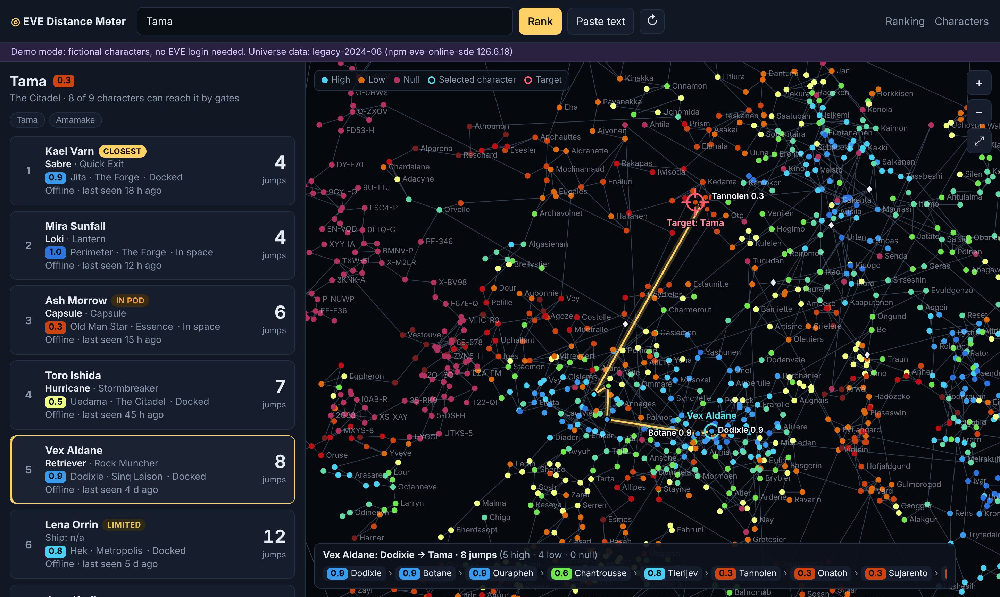

# EVE Distance Meter

Rank your EVE Online characters by **stargate jumps** to a target system, see what each one is flying, and follow the
route of the selected character on a **2D star map**: character list on the left, map on the right.



You read a notification (for example in the Discord channel of your existing bot), type the system or paste the message,
and decide which character to log in. Routes are computed in the app from CCP's static data (shortest path by gates,
same as "Shortest" on route planners). The only thing ever sent to the game client is an autopilot destination, and only
when you press **Set destination** for an online character.

## Features

- **Accounts**: each player signs in with a main character; characters added later are linked to that main and only
  that player sees them. The sign-in lasts 90 days per browser; tokens are stored encrypted (Fernet) in SQLite.
- **Wars page** (merged eve-war-bot-2): new war declarations from ESI with the systems of both sides' public
  structures; one click ranks your characters to such a system. Optional Discord posting. Settings in `config/wars.yaml`.
- **War statistics and loot list**: every active war in New Eden (census), and the public high-sec structures of
  both sides sorted by jumps from your nearest character.
- **Structures page** (structure scout, members of one alliance only): every player-owned structure in any space
  where any registered character holds an asset (ESI assets, then ESI structure info), pooled for all members,
  nearest first, owners at war marked. **Resolve unknown** reads the structures still missing a name, owner or system
  in the background with the characters that hold assets there (your main last), waiting out ESI's error limit;
  what nobody here may read is filled from public data and marked *Historical details*:
  EVE Ref, then a local index built by `scripts/build_structure_index.py` (`data/structure-index.jsonl`), then
  Adam4EVE.
- **Structure alerts** (Alerts page): zKillboard's live killmail feed shows structures **destroyed** (citadels,
  engineering complexes and refineries drop their quantum core), **combat** within 1000 km of a known structure, and
  structures **firing**, in all space. Combat and firing alerts are kept only for kills with a **battleship or capital
  hull (T2 included)** or a single loss above **500M ISK** (`alerts.big_kills_only`, `alerts.min_value_isk`); the
  *capitals* filter shows only kills with at least one capital on each side. Each alert lists your three closest characters; browser notification, sound
  and an optional Discord webhook. Attack timers themselves are not public, so these killmail signals are the hint.
  ([screenshot](docs/screenshots/alerts-desktop.png))
- **Set destination**: one click sets the in-game autopilot destination of an online character (its row on the
  Ranking page, and the Alerts page; scope `esi-ui.write_waypoint.v1`).
- **Thera / Turnur filter** (Ranking page): choose *Gates only*, *Thera* or *Turnur* next to the target box. Each
  button uses only its own hub as the mid-system, with the wormholes that [EVE-Scout](https://www.eve-scout.com/#/)
  lists for it. For each character it takes the listed system closest by gates (higher security wins a tie), the
  wormhole into the hub and out again, and the listed system closest to the target, then gates on; the two-leg route
  replaces the gate route only when it is shorter and is drawn on the map (gold gate legs, dashed purple wormhole).
  Connections marked *End Of Life* are kept, J-space exits are skipped (no gates). The list is cached and read at
  most **every 15 minutes** (`EVEDM_EVESCOUT_REFRESH_S`, 900 s); if EVE-Scout is down the last list is used.
  The route bar shows each system's **InSig / OutSig** next to the entry and exit system, and the wormhole hop carries
  an icon for the **smallest ship size** of the two neighbouring signatures (small, medium, large, X-large, capital).
- **Ansiblex mode** (Ranking page): a fourth radio button routes each character over stargates plus the Ansiblex
  jump gates **that character can see** (ESI structure search `esi-search.search_structures.v1`, gate details
  `esi-universe.read_structures.v1`; each gate is one jump). ESI has no list of gates or their access lists, so a
  gate the character finds in the search is treated as usable. Characters must re-authorize once for the new scope;
  the first run reads the gates in the background (`ansiblex.*`).
- **Remembered per browser** (cookie): Alerts filters and notification choice, Wars tab and filters, Structures
  filters, map options, ranking auto-refresh.
- **Notifications** (Notifications page, members of one alliance only): the ESI notifications of **every registered
  character with a valid token**, whoever linked it - assets moved to **asset safety**, structures **under attack**,
  fuel and state - read once per ESI cache window (600 s per character, at ESI's own expiry), each with the character (and its main),
  the system, its region, EVE time (no local time), a violet **Thera** or orange **Turnur** label for whichever is
  closer to the system, and your closest characters from both the Characters and the Roster set; live characters show
  their route type (gates, Thera or Turnur), roster characters jumps only. A character is checked only when its *Notifications* tick on the Characters page is
  on (default) **and** it has at least **1 player structure with assets** (NPC stations do not count;
  `notifications.min_structures`, 0 = everybody). The next check is scheduled at ESI's cache expiry (not a fixed 10 minutes), and
  transient ESI errors are retried after 60 s; this removes the up-to-15-minute delays. `evedm notifications lag` shows where the remaining time goes. The characters' reads are
  spread over ESI's 10-minute window (`notifications.stagger_s`), so a notification that several characters receive
  shows up after the earliest of them; the page is told at once when something new is stored (long poll) instead
  of waiting for its timer. New notifications are also **posted to Discord** through the wars webhook
  (`EVEDM_WARS_DISCORD_WEBHOOK`, or their own `EVEDM_NOTIFICATIONS_DISCORD_WEBHOOK`): one message per event, edited
  to list every character that received it; nothing older than an hour is posted; `EVEDM_NOTIFICATIONS_DISCORD_ENABLED=0`
  switches it off.
  Everything else ESI sends is one tick away in the filters. Tick **Sound** for a short chime when a new notification
  matching your filters arrives while the page is open (tick it again after a reload: browsers only allow sound after
  a click). Needs `esi-characters.read_notifications.v1`.
- **Page help and phones**: the explanations of each page sit behind the **i** button in the top bar. On a phone
  the ranking opens on a full-width map; the gear button on the map opens the target box, route options and
  auto-refresh, the route bar sits above the ranked characters, and the page links scroll sideways and keep their
  position from page to page.
- **Members-only tabs**: Notifications and Structures are visible only when the main that signed in belongs to the
  configured alliance (BB, `access.alliance_ids`, default 99010320; read from ESI at sign-in and every 6 h). For any
  other character both links are hidden and the pages answer 404.
- **Static roster** (Roster page): upload a JSON file of character names and systems (any number of entries, no tokens,
  nothing read from ESI) and rank it by jumps against the same target on the **Roster** tab of the ranking view.
  Unknown systems are kept with suggestions instead of being thrown away; the closest roster characters also appear
  under the live ones on the Alerts page.
- **JSON import/export** of characters with refresh and access tokens (schema `evedm-characters` v1), with a per-character report.
- Target by **autocomplete** or by **pasting text**: Dotlan links, in-game `showinfo` links, zKillboard links and plain names.
- Ranking by jumps (unreachable J-space / Pochven last), ship, docked / in space, online / last seen, **Closest** badge.
- 2D **star map** (canvas): zoom, pan, pinch, route with security colours, all characters marked; phone layout puts the map on top.
- Runs comfortably on **2 vCPU / 1 GB RAM**: ~74 MB idle, ~78 MB peak, 420 req/s in a container limited to 2 CPUs / 1 GB
  ([measurements](docs/wiki/05-Performance.md)).
- Every launch recorded (DB table + `logs/launches.jsonl`); rotating log with secrets redacted.
- Pinned, stable dependencies in `requirements.txt`, verified by tests and by `evedm check` (dependencies + absolute,
  existing resource paths) at start-up and at image build time.

## Quick start

### Demo (no EVE application needed)

```
docker run --rm -p 8080:8080 -e EVEDM_DEMO=1 -e EVEDM_SECRET_KEY=demo ghcr.io/headruner/war-bot-2:latest
```

Open <http://localhost:8080/?target=Tama>. Or from source (Python 3.13):

```
py -3.13 -m venv .venv                                # Linux: python3.13 -m venv .venv
. .venv/bin/activate                                   # Windows: .venv\Scripts\Activate.ps1
pip install -e .
evedm --demo serve                                     # http://localhost:8080
evedm --demo rank Tama                                 # console ranking
```

A ready-made demo database is in [`data/demo/evedm.sqlite3`](data/demo) (key `demo-secret-key-change-me`).

### Your characters

1. Create an application at <https://developers.eveonline.com/applications> with callback `http://<host>:8080/sso/callback`
   and scopes `esi-location.read_location.v1`, `esi-location.read_ship_type.v1`, `esi-location.read_online.v1`,
   `esi-characters.read_notifications.v1` (Notifications page), `esi-universe.read_structures.v1`, `esi-assets.read_assets.v1` (Structures page), `esi-search.search_structures.v1` (Ansiblex routes) and `esi-ui.write_waypoint.v1`
   (Set destination). Characters signed in before a scope was added: **Add character** again to grant it.
2. `cp .env.example .env` and fill in `EVE_CLIENT_ID`, `EVE_CLIENT_SECRET`, `EVEDM_SECRET_KEY`, `EVEDM_ALLOWED_LOGIN_CHARACTERS`.
3. `docker compose pull && docker compose up -d --no-build` with `EVEDM_IMAGE=ghcr.io/headruner/war-bot-2:latest`
   (the published image, nothing is built; Linux or Windows with Docker Desktop; updates: `scripts/update.sh` on
   Linux, `scripts\update.ps1` on Windows, see [Run on Windows](#run-on-windows)). Data stays in `./data` on the host, mounted at
   `/app/data` (one-file SQLite database in WAL mode + logs). On a Linux host run `sudo chown -R 10001:10001 data` once:
   the container runs as the non-root user 10001.
4. Sign in, then **Characters > Add character** or **Import JSON**.

On a Linux VM follow [Run in Docker on a Linux VM](#run-in-docker-on-a-linux-vm).

The shipped image in `image/` is the older 0.3.0 (no accounts, no Wars page); load it with
`docker load -i evedm-image-0.3.0-amd64.tar.gz`
(split into parts: `scripts/load-image.sh` or `scripts\load-image.ps1`).

## Run on Windows

Windows runs the **published Docker image** (built by CI, tested on Python 3.13), not the source code. You need
Docker Desktop (Linux containers) and the repository only for `docker-compose.yml`, `.env.example` and the scripts;
Python is not needed.

```powershell
git clone https://github.com/Headruner/war-bot-2.git evedm ; cd evedm       # once; later: git pull
Copy-Item .env.example .env                                               # fill in EVE_CLIENT_ID, EVE_CLIENT_SECRET, EVEDM_SECRET_KEY
docker login ghcr.io                                                       # only if the package is private (token with read:packages)
powershell -ExecutionPolicy Bypass -File .\scripts\update.ps1
```

`scripts\update.ps1` pulls `ghcr.io/headruner/war-bot-2:latest` (or the `EVEDM_IMAGE` set in `.env`, e.g. a release such
as `...:v0.8.0`), starts the container, waits until it is healthy and prints the address (<http://localhost:8080>).
Re-run it to update. `-Build` builds the image from your checkout instead (for local changes), `-Push` pushes the
checkout to GitHub first.

The EVE application callback must be exactly `http://localhost:8080/sso/callback`. Demo without an EVE application:
`docker run --rm -p 8080:8080 -e EVEDM_DEMO=1 -e EVEDM_SECRET_KEY=demo ghcr.io/headruner/war-bot-2:latest`.

Running or testing from source on Windows needs Python 3.13 (`winget install Python.Python.3.13`), see
[Development](#development).

## Run in Docker on a Linux VM

Complete runbook for an Ubuntu/Debian VM with 1 or more vCPU and 1 GB RAM. Run the commands in order. Replace
`<user>` and `<vm-address>` with your VM login and IP, and `<port>` with `8080` unless it is taken. The app is one
container (`evedm`); everything persistent lives in `./data` on the VM (one-file SQLite database + logs).

### 1. Connect to the VM

From PowerShell (Windows) or a terminal:

```bash
ssh <user>@<vm-address>
```

### 2. Install the basic tools

```bash
sudo apt update
sudo apt install -y git curl openssl
```

### 3. Install Docker

```bash
curl -fsSL https://get.docker.com | sudo sh
sudo systemctl enable --now docker
sudo usermod -aG docker $USER
newgrp docker
docker version
docker compose version
```

Both version commands must print without errors (Compose v2).

### 4. Get the code

Way A, from GitHub (a private repository: sign in first):

```bash
sudo apt install -y gh
gh auth login
git clone -b main https://github.com/Headruner/war-bot-2.git evedm
cd evedm
```

Way B, copy the folder from a Windows PC. The first command runs in PowerShell on the PC, the rest on the VM:

```bash
scp -r C:\Users\andre\source\repos\evedm <user>@<vm-address>:~/
```

```bash
cd ~/evedm
rm -rf data logs .perf-data .ruff_cache
sed -i 's/\r$//' .env .env.example scripts/*.sh
chmod +x scripts/*.sh
```

The `sed` removes Windows line endings and the `chmod` restores the execute bit that the copy loses. This way also
copies the PC's `.env`; step 6 edits it.

### 5. Register the EVE application

At <https://developers.eveonline.com/applications> create an application with

- callback `http://<vm-address>:<port>/sso/callback`, identical to `EVE_CALLBACK_URL` in step 6 (scheme, host, port);
- the scopes `esi-location.read_location.v1`, `esi-location.read_ship_type.v1`, `esi-location.read_online.v1`,
  `esi-characters.read_notifications.v1` (Notifications page), `esi-universe.read_structures.v1`,
  `esi-assets.read_assets.v1` (Structures page), `esi-search.search_structures.v1` (Ansiblex routes) and `esi-ui.write_waypoint.v1` (Set destination). A scope missing on
  the application makes EVE SSO answer `invalid_scope`.

Note the Client ID and the Secret.

### 6. Create and fill `.env`

Way A starts from the template; with Way B an `.env` already exists, so skip the first command.

```bash
cp .env.example .env
sed -i "s|^EVEDM_SECRET_KEY=.*|EVEDM_SECRET_KEY=$(openssl rand -base64 48 | tr -d '\n')|" .env
ss -ltn | grep ':8080 '
nproc
nano .env
```

`ss` printing a line means port 8080 is taken: use `8082` as `<port>` here and in step 5. `nproc` is the number of
CPUs of the VM. In `nano` check these lines (save: Ctrl+O, Enter, Ctrl+X):

```
EVEDM_SECRET_KEY=<filled by the sed command, keep it>
EVE_CLIENT_ID=<from step 5>
EVE_CLIENT_SECRET=<from step 5>
EVE_CALLBACK_URL=http://<vm-address>:<port>/sso/callback
EVEDM_PUBLISH=<port>
EVEDM_CPUS=1
EVEDM_ALLOWED_LOGIN_CHARACTERS=<your character ID>
```

- `EVEDM_CPUS=1` on a 1-vCPU VM, otherwise `2` (Docker refuses a limit above the host's CPU count).
- Your character ID is the number in `zkillboard.com/character/<id>/`; empty means anyone may sign in.
- `EVEDM_PUBLISH=127.0.0.1:<port>` makes the app reachable from the VM only (reverse proxy, Tailscale).
- Keep a copy of `EVEDM_SECRET_KEY`: a new key makes the stored tokens unreadable.

### 7. Pull and start

```bash
scripts/update.sh --no-git
```

Nothing is built on the VM: the image comes from GHCR, where the `ci` workflow publishes it after the tests pass
(`ghcr.io/headruner/war-bot-2:latest`; set `EVEDM_IMAGE` in `.env` to pin a release such as `...:v0.8.0`). The script gives
`data/` to uid 10001 (the container user), lowers `EVEDM_CPUS` to the VM's CPU count, runs `docker compose pull` and
`docker compose up -d`, waits until the container is healthy and prints the address and the image revision. A private
package needs `docker login ghcr.io` once (a token with `read:packages`), or make the package public. By hand, the same is:

```bash
mkdir -p data
sudo chown -R 10001:10001 data
EVEDM_IMAGE=ghcr.io/headruner/war-bot-2:latest docker compose pull evedm
EVEDM_IMAGE=ghcr.io/headruner/war-bot-2:latest docker compose up -d --no-build
```

To build from the checked-out source instead: `scripts/update.sh --no-git --build` (the first build takes a few minutes).

### 8. Verify

```bash
docker compose ps
curl -s http://127.0.0.1:<port>/api/health
docker compose logs --tail 50 evedm
```

`docker compose ps` must show `healthy`.

### 9. Open the firewall (private network only)

```bash
sudo ufw status
sudo ufw allow <port>/tcp
```

Skip this when `ufw` is inactive. For access from outside use Tailscale and set `EVEDM_COOKIE_SECURE=1`
([Deployment](docs/wiki/04-Deployment.md), phone access).

### 10. Sign in

Open `http://<vm-address>:<port>/`, sign in with EVE, then **Characters > Add character**.

### Apply a change

| What you changed | Command |
| --- | --- |
| `.env` | `docker compose up -d` (recreates the container; **`restart` does not re-read `.env`**) |
| `config/wars.yaml` (mounted read-only) | `docker compose restart evedm` |
| `config/evedm.example.yaml` (copied into the image as `/app/config/evedm.yaml`) | `docker compose up -d --build` |
| new code (Way A) | `scripts/update.sh` (git pull for the compose file and config, then pull the published image; `--build` builds locally; `--force-sync` after a force-push of `main`) |

Environment variables from `.env` always override the YAML files, so a value set in both places is taken from `.env`.

To edit the main YAML without rebuilding, mount a copy of it with a `docker-compose.override.yml` next to
`docker-compose.yml` (Compose merges it automatically), then run `docker compose up -d`:

```yaml
services:
  evedm:
    volumes:
      - ./config/evedm.yaml:/app/config/evedm.yaml:ro   # cp config/evedm.example.yaml config/evedm.yaml
```

### Daily operation

```bash
cd ~/evedm
docker compose logs -f evedm                          # follow the log
docker compose stop evedm                             # stop (data stays)
docker compose start evedm                            # start again
docker compose down                                   # remove the container (data stays)
docker compose stop evedm && cp -a data data-backup-$(date +%F) && docker compose start evedm   # backup
```

### Troubleshooting

| Symptom | Fix |
| --- | --- |
| `evedm check` stops the start with a permission message | `sudo chown -R 10001:10001 data` |
| `denied` / `unauthorized` when pulling the image | `docker login ghcr.io -u <github user>` with a token that has `read:packages`, or make the package public |
| `Range of CPUs is from 0.01 to 1.00` | one vCPU: `EVEDM_CPUS=1` in `.env` (`scripts/update.sh` does it for you) |
| `port is already allocated` | free port in `EVEDM_PUBLISH`, same port in `EVE_CALLBACK_URL` and on the EVE application |
| SSO error about redirect / callback | callback in `.env` and on the EVE application differ (scheme, host, port) |
| `invalid_scope` | a scope of step 5 is not ticked on the EVE application, or set `EVE_OPTIONAL_SCOPES=none` |
| `bad interpreter: /bin/bash^M` | Windows line endings: `sed -i 's/\r$//' scripts/*.sh` |
| `Permission denied` on `scripts/update.sh` | `chmod +x scripts/*.sh`, or run `bash scripts/update.sh --no-git` |
| container `unhealthy` or restarting | `docker compose logs --tail 50 evedm`; most often `EVEDM_SECRET_KEY` is empty |
| page not reachable from another PC | firewall (step 9), or `EVEDM_PUBLISH` is bound to `127.0.0.1` |
| `pip` fails on TLS during the build | corporate proxy: [Deployment](docs/wiki/04-Deployment.md), section 5 |

## Configuration

| Variable | Default | Meaning |
| --- | --- | --- |
| `EVEDM_SECRET_KEY` | — (required) | encrypts tokens, signs sessions |
| `EVE_CLIENT_ID`, `EVE_CLIENT_SECRET` | — | your EVE application |
| `EVE_CALLBACK_URL` | `http://localhost:8080/sso/callback` | must match the application |
| `EVEDM_PUBLISH` | `8080` | host port of `docker compose` (e.g. `8082` when 8080 is taken; change the callback too) |
| `EVEDM_CPUS`, `EVEDM_MEMORY` | `2`, `1g` | container limits of `docker compose` (`EVEDM_CPUS=1` on a 1-vCPU host) |
| `EVEDM_ALLOWED_LOGIN_CHARACTERS` | empty (anyone) | comma-separated character IDs allowed to sign in as a main |
| `EVEDM_WARS_CONFIG` | `config/wars.yaml` next to `EVEDM_CONFIG` | war watcher settings file |
| `EVEDM_WARS_ENABLED` | `true` in `config/wars.yaml` | `0` switches the war watcher off |
| `EVEDM_WARS_DISCORD_ENABLED`, `EVEDM_WARS_DISCORD_WEBHOOK` | `0`, empty | post new wars to a Discord channel |
| `EVEDM_PUBLIC_URL` | from `EVE_CALLBACK_URL` | address of the site, used in Discord links to the Wars page |
| `EVE_OPTIONAL_SCOPES` | `esi-universe.read_structures.v1 esi-assets.read_assets.v1 esi-ui.write_waypoint.v1 esi-search.search_structures.v1` | extra scopes (structure scout, Set destination); `none` = only the ranking scopes |
| `EVEDM_STRUCTURES_ENABLED` | `1` | `0` switches the structure scout and the Structures page off |
| `EVEDM_ACCESS_ALLIANCES` | `99010320` | comma-separated alliance IDs whose mains see the Notifications and Structures tabs; empty list = every signed-in main (the 0.8.0 name `EVEDM_NOTIFICATIONS_ALLIANCES` still works) |
| `EVEDM_NOTIFICATIONS_ENABLED` | `1` | `0` switches the notification poller and the Notifications page off |
| `EVEDM_ALERTS_ENABLED` | `1` | `0` switches structure alerts and the Alerts page off |
| `EVEDM_EVESCOUT_ENABLED` | `1` | `0` removes the Thera / Turnur filter |
| `EVEDM_EVESCOUT_URL`, `EVEDM_EVESCOUT_REFRESH_S` | `https://api.eve-scout.com/v2/public/signatures`, `900` | where and how often (15 min, cached) the wormhole list is read |
| `EVEDM_ALERTS_BIG_KILLS_ONLY`, `EVEDM_ALERTS_MIN_VALUE_ISK` | `1`, `500000000` | combat/firing alerts only for battleship/capital hulls or a loss above this value |
| `EVEDM_NOTIFICATIONS_MIN_STRUCTURES` | `10` | a character is polled for notifications only with this many player structures holding assets |
| `EVEDM_NOTIFICATIONS_DISCORD_ENABLED`, `EVEDM_NOTIFICATIONS_DISCORD_WEBHOOK`, `EVEDM_NOTIFICATIONS_DISCORD_MENTION_ROLE_ID` | `1`, empty, empty | notifications on Discord: on when a webhook exists; empty webhook = the wars webhook; role pinged on "structure attacked" only |
| `EVEDM_ANSIBLEX_ENABLED` | `1` | `0` removes the Ansiblex route mode |
| `EVEDM_ALERTS_CONTACT` | empty | added to the User-Agent zKillboard sees |
| `EVEDM_ALERTS_GRID_KM` | `1000` | a kill this close to a known structure is "combat" |
| `EVEDM_ALERTS_DISCORD_ENABLED`, `EVEDM_ALERTS_DISCORD_WEBHOOK`, `EVEDM_ALERTS_DISCORD_MENTION_ROLE_ID` | `0`, empty, empty | post alerts to Discord; the role is pinged on "destroyed" |
| `EVEDM_DEMO` | `0` | `1` = fictional characters, no EVE application |
| `EVEDM_DATA_DIR` | `/app/data` (image), `./data` (local) | one-file SQLite DB and logs |
| `EVEDM_SQLITE_JOURNAL` | `wal` | falls back to `delete` automatically (logged) where WAL is unsupported |
| `EVEDM_WEB_AUTH` | `sso` | `none` only on a private network |
| `EVEDM_COOKIE_SECURE` | `0` | `1` when served over HTTPS |
| `EVEDM_ESI_CONCURRENCY` | `20` | parallel ESI calls |
| `EVEDM_REFRESH_INTERVAL_S` / `EVEDM_MAX_WAIT_AGE_S` | `5` / `30` | background refresh cadence / max age served without waiting |

All settings can also go into a YAML file (`config/evedm.example.yaml`, `EVEDM_CONFIG`).

## Development

```
# Python 3.13 (the version CI tests and the image use)
pip install -r requirements-dev.txt && pip install -e . --no-deps && python -m playwright install chromium
scripts/run-tests.sh                 # unit + integration + browser + footprint; logs in logs/tests and logs/perf
ruff check src tests scripts
scripts/render-diagrams.sh           # C4 diagrams (PlantUML) -> docs/diagrams (Windows: scripts\render-diagrams.ps1)
python scripts/build_structure_index.py   # local structure index -> data/structure-index.jsonl (see docs/wiki/06)
```

CI (`.github/workflows/ci.yml`): lint → unit (Linux + Windows, Python 3.13 only) → integration + browser → footprint →
image build, smoke test under `--cpus 2 --memory 1g`, container footprint, image tarball artifact, multi-arch push to GHCR.

## Guidelines

The project follows the [architecture guidelines](docs/guidelines/architecture.md) (one-file SQLite in WAL mode on
`data/` → `/app/data`, stable pinned dependencies, verified paths, multi-stage non-root image) and the
[git guidelines](docs/guidelines/git.md) (atomic conventional commits, subjects under 50 characters).

## Documentation

[Wiki home](docs/wiki/Home.md) · [Requirements](docs/wiki/01-Requirements.md) · [Architecture (C4)](docs/wiki/02-Architecture-C4.md) ·
[Testing](docs/wiki/03-Testing.md) · [Deployment](docs/wiki/04-Deployment.md) · [Performance](docs/wiki/05-Performance.md) ·
[Operations](docs/wiki/06-Operations.md)

## Project layout

```
src/evedm/            core + web app (universe, resolver, sso, esi, characters, bundle, ranking, scout, alerts, db,
                      logs, demo, cli, wars/, web/)
src/evedm/data/       universe.json.gz (systems, gates, ship names from CCP static data)
tests/                unit/, integration/ (processes + browser), perf/, fake_eve.py
docs/                 wiki/, c4/ (PlantUML), diagrams/ (SVG/PNG), screenshots/
deploy/               docker-compose.yml for servers (named volume at /app/data)
scripts/              run-tests, docker-smoke, render-diagrams, load-image, update (.sh Linux, .ps1 Windows)
data/demo/            prepopulated demo database
logs/                 test, performance and launch logs
```

EVE Online and all related names are trademarks of CCP hf. Universe data comes from CCP's Static Data Export.
