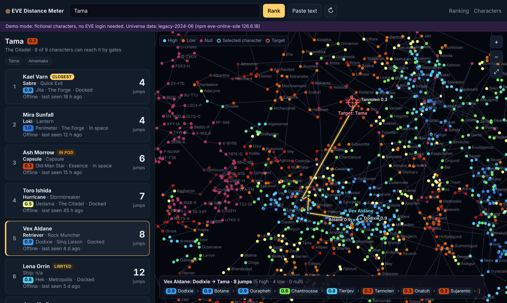

# EVE Distance Meter

Rank your EVE Online characters by **stargate jumps** to a target system, see what each one is flying, and follow the
route of the selected character on a **2D star map**: character list on the left, map on the right.



You read a notification (for example in the Discord channel of your existing bot), type the system or paste the message,
and decide which character to log in. Nothing is sent to the game client; routes are computed in the app from CCP's
static data (shortest path by gates, same as "Shortest" on route planners).

## Features

- **Accounts**: each player signs in with a main character; characters added later are linked to that main and only
  that player sees them. The sign-in lasts 90 days per browser; tokens are stored encrypted (Fernet) in SQLite.
- **Wars page** (merged eve-war-bot-2): new war declarations from ESI with the systems of both sides' public
  structures; one click ranks your characters to such a system. Optional Discord posting. Settings in `config/wars.yaml`.
- **JSON import/export** of characters with refresh and access tokens (schema `evedm-characters` v1), with a per-character report.
- Target by **autocomplete** or by **pasting text**: Dotlan links, in-game `showinfo` links, zKillboard links and plain names.
- Ranking by jumps (unreachable J-space / Pochven last), ship, docked / in space, online / last seen, **Closest** badge.
- 2D **star map** (canvas): zoom, pan, pinch, route with security colours, all characters marked; phone layout puts the map on top.
- Runs comfortably on **2 vCPU / 1 GB RAM**: ~74 MB idle, ~78 MB peak, 420 req/s in a container limited to 2 CPUs / 1 GB
  ([measurements](docs/wiki/05-Performance.md)).
- Every launch recorded (DB table + `logs/launches.jsonl`); rotating log with secrets redacted.
- Pinned, stable dependencies in `requirements.txt`, verified by tests and by `evedm check` (dependencies + absolute,
  existing resource paths) at start-up and at image build time.

## Quick start

### Demo (no EVE application needed)

```
docker run --rm -p 8080:8080 -e EVEDM_DEMO=1 -e EVEDM_SECRET_KEY=demo evedm:0.3.0
```

Open <http://localhost:8080/?target=Tama>. Or without Docker:

```
python -m venv .venv && . .venv/bin/activate          # Windows: .venv\Scripts\activate
pip install -e .
evedm --demo serve                                     # http://localhost:8080
evedm --demo rank Tama                                 # console ranking
```

A ready-made demo database is in [`data/demo/evedm.sqlite3`](data/demo) (key `demo-secret-key-change-me`).

### Your characters

1. Create an application at <https://developers.eveonline.com/applications> with callback `http://<host>:8080/sso/callback`
   and scopes `esi-location.read_location.v1`, `esi-location.read_ship_type.v1`, `esi-location.read_online.v1`.
2. `cp .env.example .env` and fill in `EVE_CLIENT_ID`, `EVE_CLIENT_SECRET`, `EVEDM_SECRET_KEY`, `EVEDM_ALLOWED_LOGIN_CHARACTERS`.
3. `docker compose up -d --build` (Linux or Windows with Docker Desktop). Data stays in `./data` on the host, mounted at
   `/app/data` (one-file SQLite database in WAL mode + logs). On a Linux host run `sudo chown -R 10001:10001 data` once:
   the container runs as the non-root user 10001.
4. Sign in, then **Characters > Add character** or **Import JSON**.

Load the shipped image instead of building: `docker load -i evedm-image-0.3.0-amd64.tar.gz`
(split into parts: `scripts/load-image.sh` or `scripts\load-image.ps1`).

## Configuration

| Variable | Default | Meaning |
| --- | --- | --- |
| `EVEDM_SECRET_KEY` | — (required) | encrypts tokens, signs sessions |
| `EVE_CLIENT_ID`, `EVE_CLIENT_SECRET` | — | your EVE application |
| `EVE_CALLBACK_URL` | `http://localhost:8080/sso/callback` | must match the application |
| `EVEDM_ALLOWED_LOGIN_CHARACTERS` | empty (anyone) | comma-separated character IDs allowed to sign in as a main |
| `EVEDM_WARS_CONFIG` | `config/wars.yaml` next to `EVEDM_CONFIG` | war watcher settings file |
| `EVEDM_WARS_ENABLED` | `true` in `config/wars.yaml` | `0` switches the war watcher off |
| `EVEDM_WARS_DISCORD_ENABLED`, `EVEDM_WARS_DISCORD_WEBHOOK` | `0`, empty | post new wars to a Discord channel |
| `EVEDM_DEMO` | `0` | `1` = fictional characters, no EVE application |
| `EVEDM_DATA_DIR` | `/app/data` (image), `./data` (local) | one-file SQLite DB and logs |
| `EVEDM_SQLITE_JOURNAL` | `wal` | falls back to `delete` automatically (logged) where WAL is unsupported |
| `EVEDM_WEB_AUTH` | `sso` | `none` only on a private network |
| `EVEDM_COOKIE_SECURE` | `0` | `1` when served over HTTPS |
| `EVEDM_ESI_CONCURRENCY` | `20` | parallel ESI calls |
| `EVEDM_REFRESH_INTERVAL_S` / `EVEDM_MAX_WAIT_AGE_S` | `5` / `30` | background refresh cadence / max age served without waiting |

All settings can also go into a YAML file (`config/evedm.example.yaml`, `EVEDM_CONFIG`).

## Development

```
pip install -r requirements-dev.txt && pip install -e . --no-deps && python -m playwright install chromium
scripts/run-tests.sh                 # unit + integration + browser + footprint; logs in logs/tests and logs/perf
ruff check src tests scripts
scripts/render-diagrams.sh           # C4 diagrams (PlantUML) -> docs/diagrams
```

CI (`.github/workflows/ci.yml`): lint → unit (Linux + Windows, Python 3.12/3.13) → integration + browser → footprint →
image build, smoke test under `--cpus 2 --memory 1g`, container footprint, image tarball artifact, multi-arch push to GHCR.

## Guidelines

The project follows the [architecture guidelines](docs/guidelines/architecture.md) (one-file SQLite in WAL mode on
`data/` → `/app/data`, stable pinned dependencies, verified paths, multi-stage non-root image) and the
[git guidelines](docs/guidelines/git.md) (atomic conventional commits, subjects under 50 characters).

## Documentation

[Wiki home](docs/wiki/Home.md) · [Requirements](docs/wiki/01-Requirements.md) · [Architecture (C4)](docs/wiki/02-Architecture-C4.md) ·
[Testing](docs/wiki/03-Testing.md) · [Deployment](docs/wiki/04-Deployment.md) · [Performance](docs/wiki/05-Performance.md) ·
[Operations](docs/wiki/06-Operations.md)

## Project layout

```
src/evedm/            core + web app (universe, resolver, sso, esi, characters, bundle, ranking, db, logs, demo, cli, web/)
src/evedm/data/       universe.json.gz (systems, gates, ship names from CCP static data)
tests/                unit/, integration/ (processes + browser), perf/, fake_eve.py
docs/                 wiki/, c4/ (PlantUML), diagrams/ (SVG/PNG), screenshots/
deploy/               docker-compose.yml for servers (named volume at /app/data)
scripts/              run-tests, docker-smoke, render-diagrams, load-image
data/demo/            prepopulated demo database
logs/                 test, performance and launch logs
```

EVE Online and all related names are trademarks of CCP hf. Universe data comes from CCP's Static Data Export.
