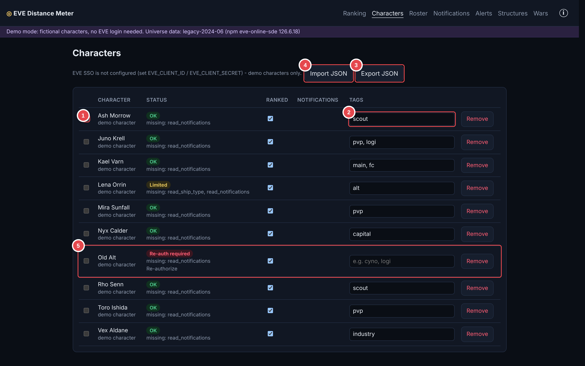

# 1. Getting started: sign in and add characters

Goal: sign in once with your main character, add your other characters, and decide which of them take part in the ranking.

## Sign in

1. Open the site address you were given. If the site asks you to sign in, press **Sign in with EVE Online**.
2. EVE's own login page opens. Log in with your **main** character and approve the permissions it lists. The site never sees your password.
3. You come back to the site on the **Characters** page with the message "Welcome ... Your main is linked".

You stay signed in on this browser for the number of days shown in the page help (the **i** button), counted from your last visit, so you do not sign your alts in again.

The characters you add are linked to your main and only you can see them.

> A demo site has no EVE login, so there is no sign-in screenshot. Instead of the sign-in button the Characters page shows "EVE SSO is not configured ... demo characters only".

## Add your other characters

1. Open **Characters** in the top menu.
2. Press **Add character (EVE SSO)** (not visible in the demo) and log in with the next character. It is linked to your main and appears in the table.
3. Repeat for every character you want to rank or watch.

## Read the table

- **Status** `OK` means the site can read this character. `Limited` means a permission is missing; the line below names it (for example a missing ship permission), and that part of the data stays empty. `Re-auth required` means the saved login expired: press **Add character** and log in with that character again.
- **Ranked** decides whether the character takes part in the Ranking page. Untick it to hide a character without removing it.
- **Notifications** shows whether the character's in-game notifications are read; this needs the notifications permission.
- **Tags** are free words such as `scout`, `pvp` or `hauler`, separated by commas. Tags are shown on the Ranking page and can be used on the Roster page filters.

## What the markers show

1. **Tick box** at the start of a row: selects the character for **Export JSON**.
2. **Tags** field: type a few words and leave the field to save them.
3. **Export JSON**: downloads the ticked characters (all of them if none is ticked). The file contains credentials, so keep it private.
4. **Import JSON**: loads such a file, for example to move your characters to another site.
5. A row with **Re-auth required**: add that character again to fix it. **Remove** at the end of any row deletes the character from the site.

## Share structures with your group

A character that granted the structure permissions shares the player-owned structures where it has assets with everyone on the site (see [Structures](06-structures.md)). To grant them, press **Add character** again for that character and accept the extra permissions.

## Leave the site

The **Account** block at the bottom of the page has **Delete account**. It removes your main and all linked characters from the site.
