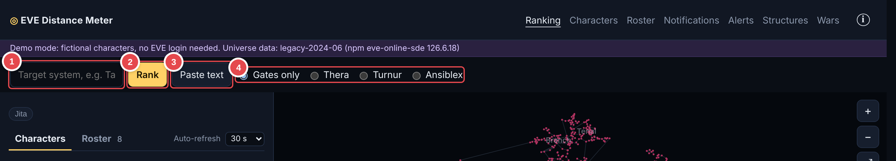
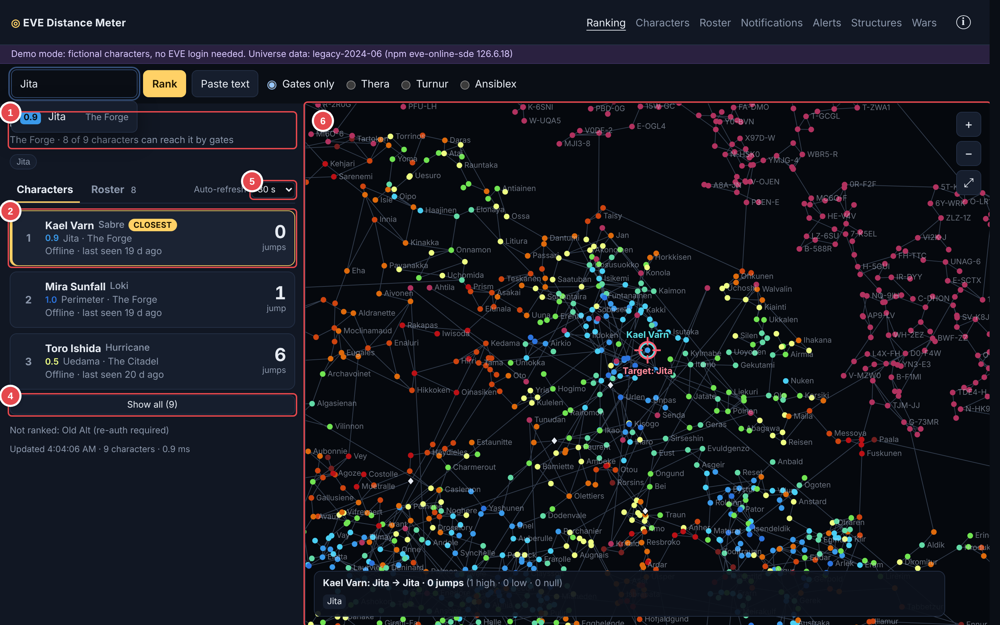
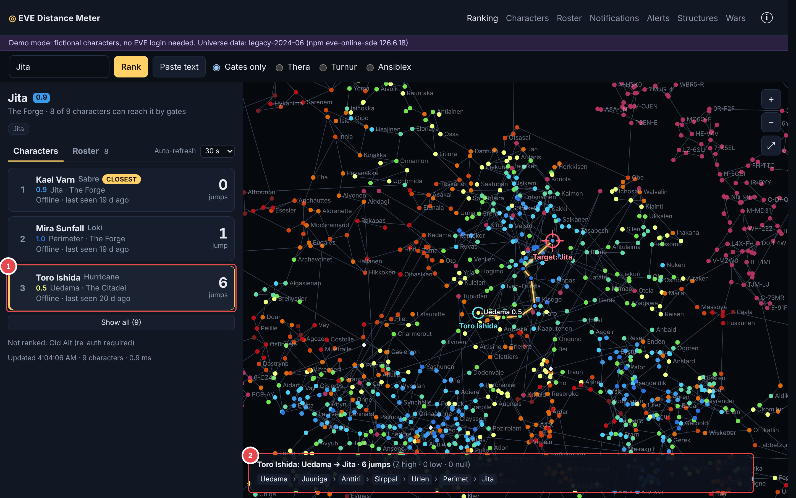
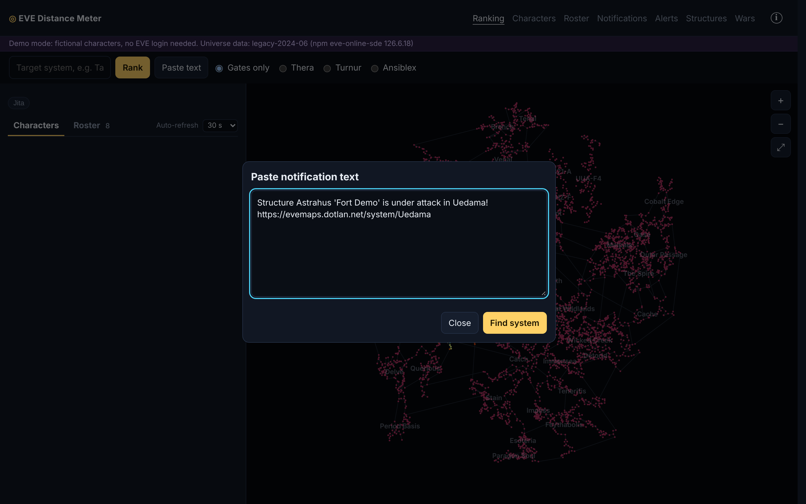
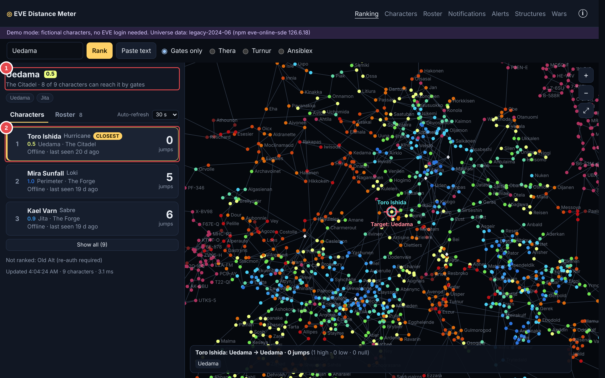
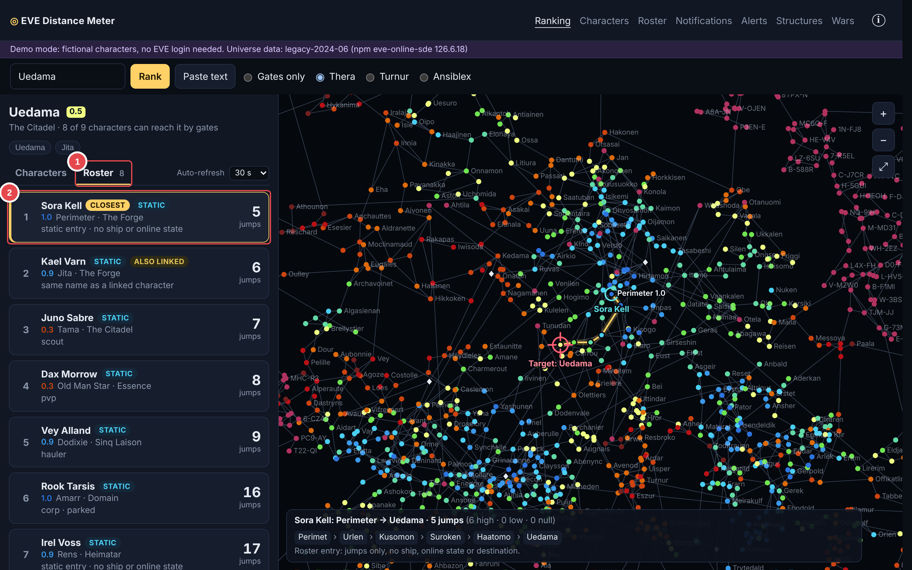
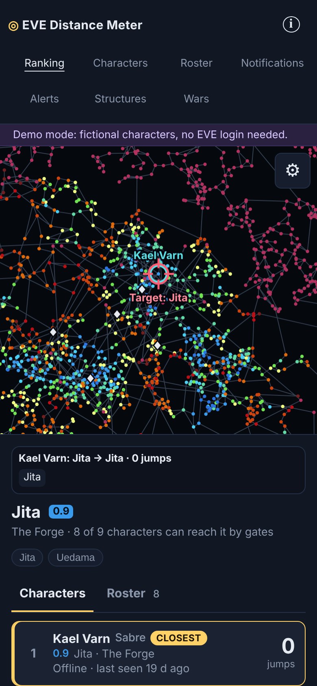
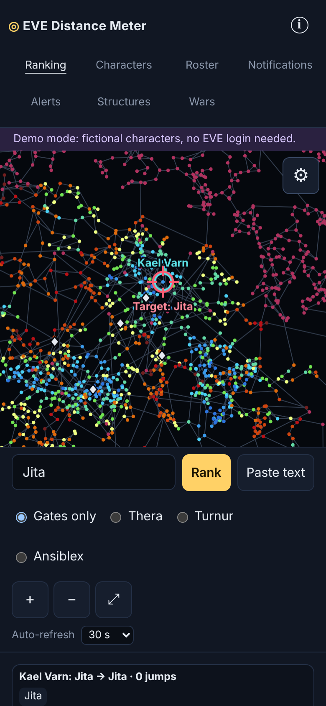

# 2. Ranking: which character is closest?

Goal: name a system and see all your characters ordered by the number of stargate jumps to it, with the route drawn on the map.

## Rank a system

1. Click the **Target system** field (1) and start typing a system name, for example `Jita`. A list of matching systems with their region and security appears; pick one or press Enter.
2. Press **Rank** (2).
3. Optional: choose how the route may travel with the buttons at the right (4). **Gates only** counts stargates only. **Thera**, **Turnur** and **Ansiblex** also use those shortcuts, when the site has the data for them (Thera and Turnur come from EVE-Scout).

4. The left side now shows the target (1): its name, security status (colour-coded), region, and how many characters can reach it by gates. Below it are small buttons with your recent targets; press one to rank it again.
5. The list (2) shows the characters from the nearest to the farthest, with the ship, the home system, the online state and the number of **jumps**. The closest one carries a yellow **CLOSEST** tag.
6. Only the three closest are listed. Press **Show all** (4) to see the rest.
7. Characters that cannot be ranked (for example **Re-auth required**) are named under the list as "Not ranked".
8. **Auto-refresh** (5) re-reads where the characters are every 15 s, 30 s, 1 or 2 minutes. Set it to **off** to stop.
9. The map (6) shows the target with a red marker. Use **+**, **−** and **⤢** to zoom and fit the view, drag to move, and hover over a system for its details.

## See the route of one character

1. Click a character in the list (1).
2. The map highlights the path from that character to the target, and the bar at the bottom of the map (2) summarises it: jumps, and how many of the systems on the way are high-sec, low-sec or null-sec.

## Rank from a pasted message

Use this when someone sends you a Discord message such as "structure under attack in Uedama".

1. Press **Paste text** next to **Rank**.
2. Paste the whole message into the text box (1). A Dotlan link or a plain system name in it is recognised.
3. Press **Find system** (2). The dialog closes and the system is ranked at once.

The target field now holds the recognised system (1) and the list (2) shows who is closest.

If the message contains no system, the dialog tells you so and stays open. Correct the text, or close it and type the system into the target field.

## Roster tab

1. Press **Roster** (1) above the list, next to **Characters**. The number is how many roster entries you have.
2. The same target is ranked for the entries of your [static roster](03-roster.md) (2). Roster entries show jumps only, with no ship, online state or destination button.

## Use it on a phone

On a narrow screen the map is on top and the character list is below it. Press a recent target to rank it again, or tap the gear button on the map to open the controls.

The gear opens the target field, the route options, the map buttons and the auto-refresh setting.

## Tips

- An online character has a **Set destination** button that sets its in-game autopilot destination to the target; it needs the waypoint permission, which you grant when you add the character.
- Wormhole systems have no stargates, so no jumps are counted to them.
