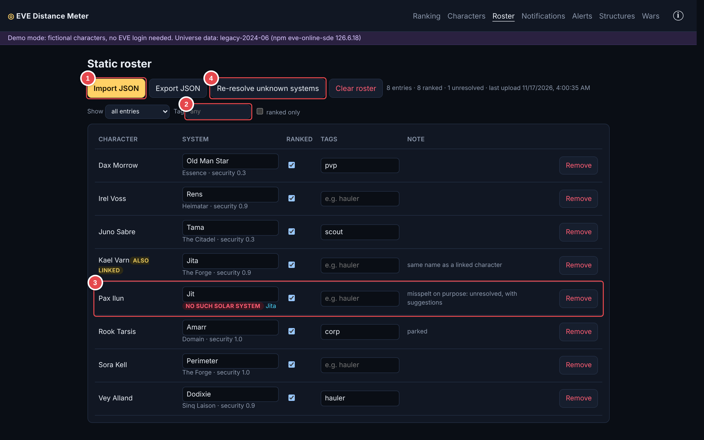

# 3. Static roster: rank characters that cannot sign in

Goal: include characters in the ranking that are not linked through EVE login, for example a corp's alt list or characters parked in other systems. You upload a JSON file with names and systems; you do not give the site any login for them.

A roster entry has no tokens, so the site never reads anything from EVE for it. It shows no ship, no online state and no **Set destination** button, only the number of jumps.

## Prepare the file

Save this as `roster.json` and change the names and systems:

```json
{
  "schema": "evedm-static-roster",
  "version": 1,
  "label": "Alt parking list",
  "characters": [
    { "char_name": "Tanya Vermaak", "star_system_name": "Perimeter", "tags": ["hauler"], "note": "Jita alt" },
    { "char_name": "Rork Sanhai", "star_system_name": "Osmon" }
  ]
}
```

`tags` and `note` are optional. A plain list of such entries without the outer object is accepted as well.

## Upload and manage it



1. Open **Roster** in the top menu and press **Import JSON** (1). Choose your file.
2. A report under the buttons says how many entries were added, updated, unresolved or rejected and how many are in the roster now. A file that is not valid is rejected as a whole with the reason. The file itself is not kept and its contents are not written to the log.
3. An upload merges into the existing roster by character name: a name that is already there moves to its new system and keeps its tags and its **Ranked** setting.
4. Use the filters (2) to show only some entries: by state, by tag, or only the ranked ones.
5. Edit a row (3) directly: change the system, tick or untick **Ranked**, type tags, or press **Remove**.
6. A system name that does not exist is kept as an **unresolved** entry with a red label and suggested names (for example `Jit` suggests `Jita`). Fix the name in the row, or press **Re-resolve unknown systems** (4) after correcting several entries.
7. **Export JSON** saves the current roster in the same format, and **Clear roster** deletes all entries.

A roster name that is also one of your linked characters is marked **ALSO LINKED**, because the same name would otherwise count twice.

## Where roster entries show up

- On the Ranking page, in the **Roster** tab next to **Characters** (see [Ranking](02-ranking.md)).
- Under the closest characters on the [Notifications](04-notifications.md) and [Alerts](05-alerts.md) pages, in a line starting with **Roster:**.
