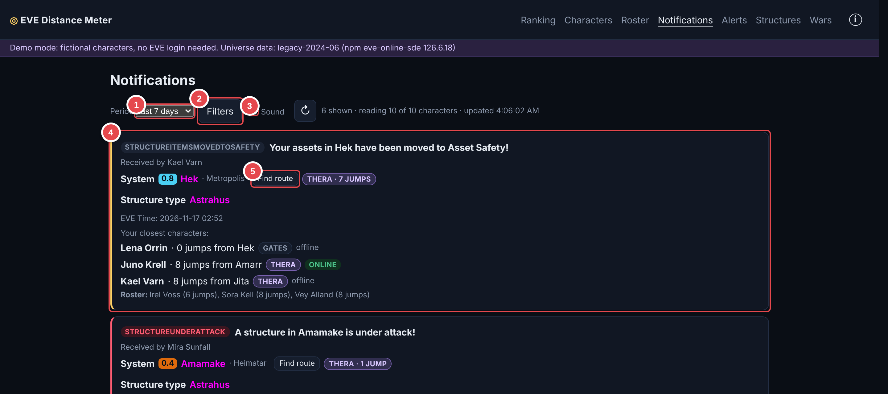
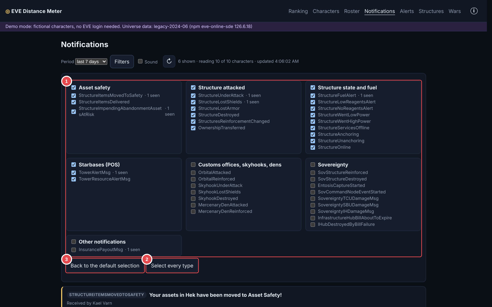

# 4. Notifications: in-game structure messages of all your characters

Goal: read the in-game notifications of every character you added (structure under attack, lost shields, asset safety and so on) in one list, and see at once which of your characters is closest to the system concerned.

The site reads the notifications of each linked character with that character's own login and refreshes them every few seconds. A character needs the notifications permission; the **Characters** page shows `missing: read_notifications` when it is absent (see [Getting started](01-getting-started.md)).

## Read the feed

1. Open **Notifications** in the top menu.
2. Choose how far back to look with **Period** (1), for example the last 7 days.
3. The line to the right of the buttons says how many notifications are shown and how many characters were read.
4. Each card (4) shows:
   - the notification type as a coloured tag and its text, for example "A structure in Amamake is under attack!";
   - **Received by**: the character whose mail it was;
   - the **System**, its security status and region, and the structure type;
   - the in-game time;
   - **Your closest characters**: up to three of your characters with the jumps to that system, how they travel (`GATES` or `THERA`) and whether they are online. Roster entries follow on a **Roster:** line.
5. Press **Find route** (5) on a card to rank that system on the Ranking page.

Asset safety notifications and structure attacks are shown by default.

## Choose what to see

1. Press **Filters** (2 in the first picture). The notification types appear in groups: asset safety, structure attacked, structure state and fuel, starbases, customs offices and skyhooks, sovereignty, and other.
2. Tick or untick a whole group (1) or single types in it. A type is shown with its name from EVE and, when it has been seen, how many came in.
3. **Select every type** (2) turns everything on; **Back to the default selection** (3) returns to the default.
4. Your choice is remembered in this browser.

A type that EVE sends and that is not in the groups appears under **Other notifications** after it has been seen once.

## Get a sound

Tick **Sound** (3 in the first picture) to hear a chime when new notifications matching your filters arrive while the page is open. Turn it on again after you reload or reopen the page.

## Get the same messages in Discord

If the site owner configured Discord, each notification type can also be posted to its own channel with a short header such as `ASSET SAFETY` or an attack name. That is set on the Settings page by the owner and needs nothing from you.
