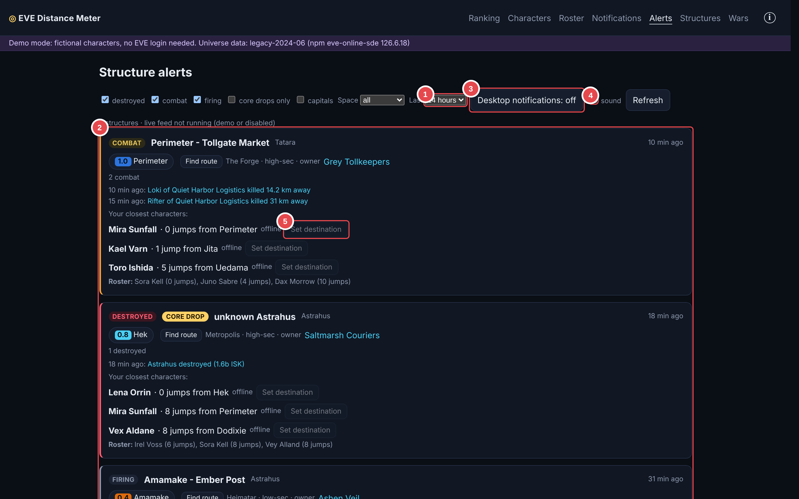

# 5. Structure alerts: destroyed structures and fights

Goal: follow structures that are destroyed, fought over or firing, as reported by zKillboard's live feed, and send a character to the scene.

Kills are kept only when a battleship or capital (T2 variants included) is on either side, or when the single killmail is worth 500 million ISK or more. Destroyed structures are always kept, except strongholds, which the site ignores. Attack timers themselves are not public, so this page shows what happened, not what is coming.

## Read the alerts

1. Open **Alerts** in the top menu.
2. The tick boxes at the top choose the kinds of alert: **destroyed** structures (citadels, engineering complexes and refineries drop their quantum core), **combat** next to a known structure, and structures **firing**. **core drops only** keeps only destroyed structures that dropped a core, and **capitals** only fights with capital ships.
3. Choose **Space** (all, high-sec, low-sec, null-sec, wormhole) and how far back to look with **Last** (1) (1 hour up to 7 days).
4. Each card (2) shows the kind of alert, the structure and its type, when it happened, the system with security status, region and the owner, then the kills with links to zKillboard. A line under the title says how many structures are listed and whether the live feed is running.
5. Under **Your closest characters** the three nearest of your characters are listed with their jumps to the system and their online state. Roster entries follow on a **Roster:** line.
6. Press **Find route** to rank the system on the Ranking page (see [Ranking](02-ranking.md)).

## Send a character there

1. Look at the closest characters on a card. An online character has a **Set destination** button (5).
2. Press it. The character's in-game autopilot destination is set to that system; no confirmation message follows. The character must have granted the waypoint permission when it was added.

The button is greyed out for a character that is offline (hover to read why) or that has to be re-authorized with **Add character** to allow it. In the demo screenshot all characters are offline.

## Be told about new alerts

1. Press **Desktop notifications: off** (3) and allow notifications in your browser. The button then reads "on", and a new alert pops up while the page is open.
2. Tick **sound** (4) to hear a chime as well.

Both settings and your tick boxes are remembered in this browser. Press **Refresh** to read the feed at once.
