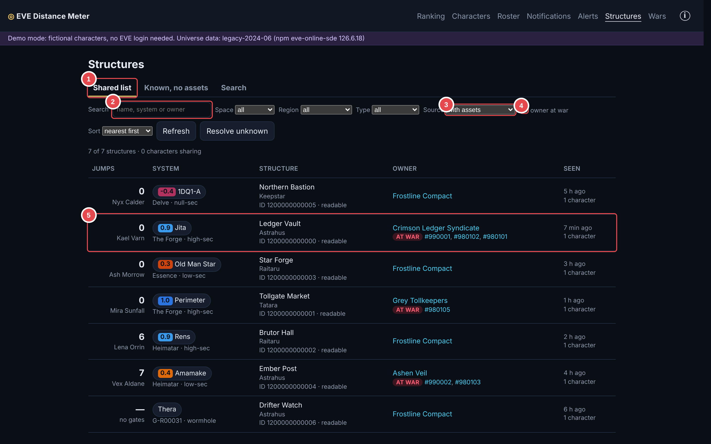
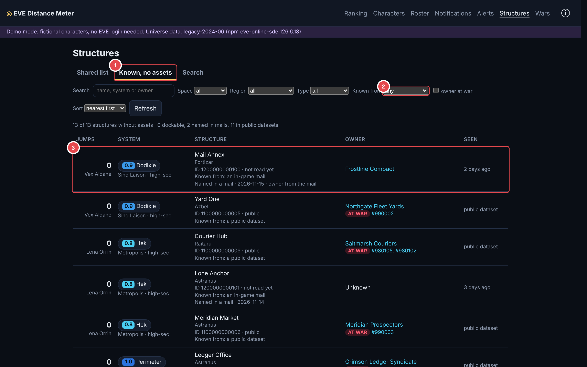
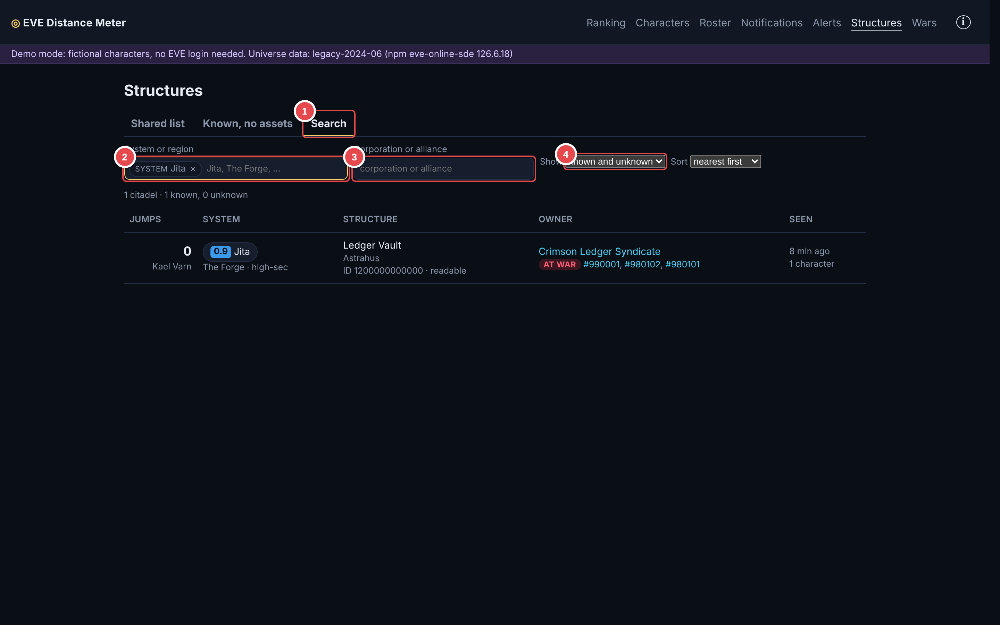

# 6. Structures: shared, known and searchable citadels

Goal: find player-owned structures near your characters, including ones you could not see in the game.

The page has three tabs.

## Shared list

1. Open **Structures** in the top menu. The first tab, **Shared list** (1), lists every structure where any character registered on this site has an asset, in all kinds of space. A character contributes once it has granted the structure permissions; add the character again to grant them (see [Getting started](01-getting-started.md)).
2. Type in **Search** (2) to filter by structure name, system or owner. The drop-downs narrow the list by **Space**, **Region** and **Type**; the number in brackets is how many structures match.
3. **Source** (3) chooses where the structures come from: *with assets* (default), *can dock, no assets* (structures that EVE's search says some character may dock at; the page shows how many characters can dock, never which), *named in mails* (structures linked in an in-game mail of a character that granted the mail permission; only the structure, its owner and the mail's date are kept, never the mail), or *all*.
4. Tick **owner at war** (4) to keep only structures whose owner is at war.
5. Each row (5) shows the jumps from the nearest character, the system with security status, the structure name and type, its ID, the owner (with the war numbers if the owner is at war) and when it was last seen. **Sort** orders by distance, system, name, type, owner, security or last seen.
6. **Refresh** reloads the list. **Resolve unknown** asks EVE for the name, owner and type of structures that are still only an ID.

## Known, no assets

Press **Known, no assets** (1). This tab lists structures that are known but where none of the registered characters has an asset. Each row says which source knows it (2): a character that may dock there, an in-game mail, or a public dataset (EVE Ref, the local index, Adam4EVE). Use the same filters as on the first tab.

## Search

1. Press **Search** (1).
2. Type a system or a region in **System or region** (2) and pick it from the list that appears. It becomes a tag in the field; add more if you wish.
3. Or type a corporation or alliance in the next field (3).
4. **Show** (4) chooses *known and unknown*, only *known*, or only *unknown* structures. The line under the fields counts the citadels found.
5. Sort the result with **Sort**.

The search finds citadels, known and unknown, by system or region and by corporation or alliance. Until you choose at least one of them, the page asks you to "Choose a system, region, corporation or alliance".

## Use a structure on the Ranking page

Click a system name or its **Find route** button to rank the structure's system and see which of your characters is nearest. Wormhole structures show "no gates" instead of jumps.
