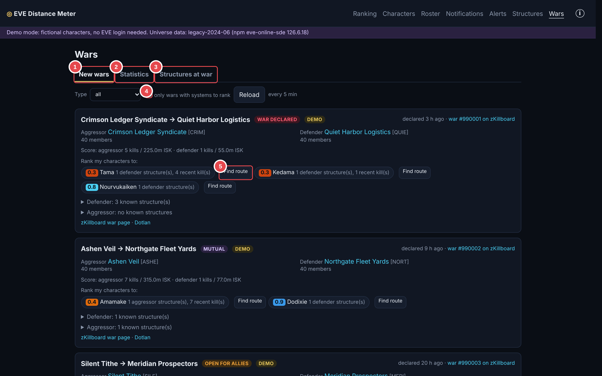
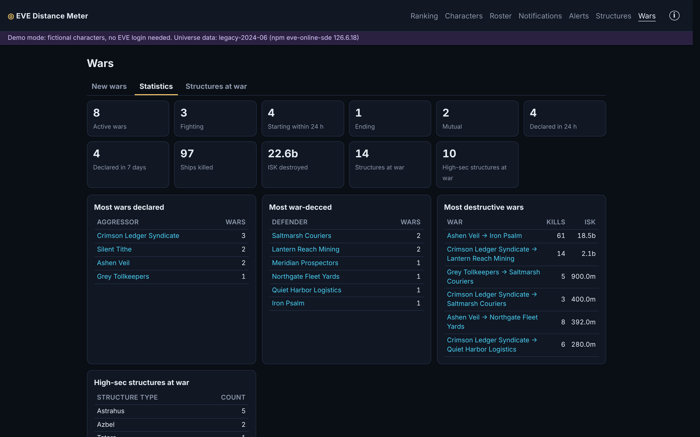
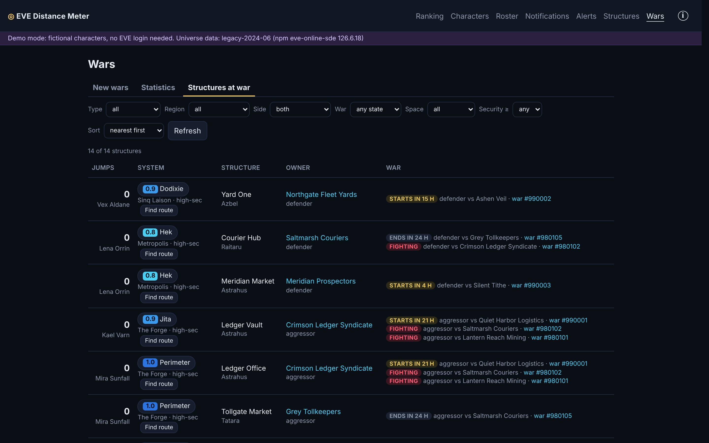

# 7. Wars: declarations, statistics and structures at war

Goal: see new war declarations, who is winning, and which structures can be attacked because of a war, and rank your characters to the systems involved.

The data is read from EVE's public war list and refreshed every five minutes.

## New wars

1. Open **Wars** in the top menu. The first tab, **New wars** (1), shows fresh war declarations with the public structures of both sides.
2. Filter by **Type** (all, war declared, mutual, open for allies). Tick **only wars with systems to rank** (4) to hide wars that have no known structure.
3. Each card shows the aggressor and the defender with their member counts, the score so far (kills and ISK on both sides), and the state of the war: *war declared*, *mutual*, *open for allies*.
4. Under **Rank my characters to** the card lists the systems where either side has a known structure or where recent kills happened. Press **Find route** (5) to rank that system; the Ranking page opens with your characters ordered by jumps (see [Ranking](02-ranking.md)).
5. Open **Defender: ... known structure(s)** and **Aggressor: ...** to see them. Links to the war on zKillboard and to Dotlan are at the bottom of the card.

## Statistics

Press **Statistics** (2 in the first picture) for every active war in New Eden (declared, fighting or ending). The tiles at the top count active wars, wars that are fighting, starting within 24 hours, ending or mutual, wars declared in the last 24 hours and 7 days, ships killed, ISK destroyed, and structures at war (and how many of them are in high-sec). Below are the rankings: most wars declared, most war-decced, most destructive wars, and high-sec structures at war by type. Names in them are links.

## Structures at war

1. Press **Structures at war** (3 in the first picture). The list shows known structures owned by either side of an active war, in all kinds of space, nearest to your characters first.
2. Narrow it with **Type**, **Region**, **Side** (aggressor, defender or both), **War** state (fighting, starts soon, ending), **Space** and a minimum **Security**. **Sort** orders by distance, security, system, structure type or owner.
3. The last column shows each war with a coloured state: *starts in ... h*, *fighting* or *ends in ... h*, and which side the owner is on.
4. Press **Find route** under a system to rank it.

Only high-sec structures can be attacked because of a war, and a structure can be shot once its war is *fighting*. Wormhole systems have no gates, so no jumps are counted to them.
