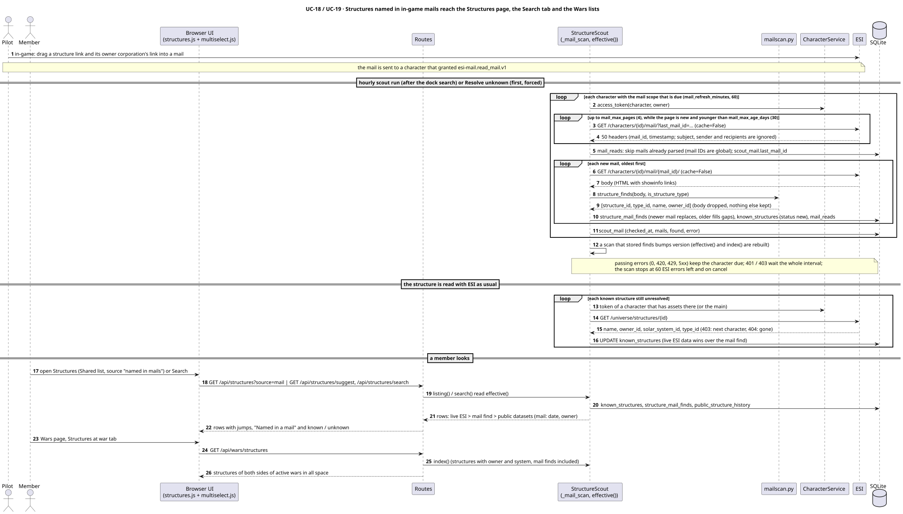

# 02 · Architecture (C4 model)

Diagrams are written in PlantUML ([`docs/c4`](../c4)) and rendered to SVG/PNG in [`docs/diagrams`](../diagrams) with
`scripts/render-diagrams.sh` (set `PLANTUML_JAR` or install `plantuml`).

## Use cases

## C1 · System context
Actors are the user, EVE SSO, ESI (which also forwards an autopilot destination to the game client on **Set
destination**), zKillboard's live killmail feed R2Z2 (structure alerts), EVE Ref's structure dataset, Discord webhooks
(optional posts) and CCP static data.

## C2 · Containers
One Python process serves the browser UI and the JSON API and runs four background tasks in its event loop: the
war watcher, the structure scout, the notification poller and the alert service. A one-file SQLite database (WAL) and the logs live on the
`/app/data` volume; the universe file is bundled. The desktop app (PySide6) is planned and will reuse the same core package.

## C3 · Components of the web app

Key mechanisms:

- **Single-flight refresh + stale-while-revalidate** (`RankingService`): concurrent rankings share one ESI round; answers come
  from snapshots younger than 30 s while a background round runs every 5 s at most. `refresh=2` (no button on the page) waits for fresh data.
- **ESI client**: Expires/ETag cache, identical in-flight requests coalesced, 20 parallel calls, 429 Retry-After. On 420 it reads `X-Esi-Error-Limit-Remain/Reset`, **stops sending until the window resets** and fails fast (`blocked_for()`); paged reads are an async generator (`iter_pages`).
- **GateGraph**: CSR adjacency arrays; one BFS per target (cached) gives every character's route through parent pointers.
- **Tokens**: Fernet-encrypted in SQLite; refreshed when less than 60 s remain; `invalid_grant` marks the character REAUTH.
- **Structure scout** (`StructureScout`): assets are read page by page and each page's structures (type `other`) are upserted at once; known structures are skipped and kept until a 404; names and owners re-read every 720 h, refused ones every 14 days; stops at 60 ESI errors left.
- **EVE-Scout** (`EveScout`): public signature list cached 15 minutes (a hub missing from the answer is fetched by name), last list kept on error; `via()` builds character → entry → hub → exit → target for the chosen hub from a multi-source BFS.
- **Structure alerts** (`AlertService`, 0.7.0): `R2Z2Feed` follows zKillboard's sequence (position kept in the `meta`
  table, 404 = caught up, 403/429 = 10 min pause). Each killmail is classified against the known structures of its
  system (scout finds + EVE Ref, positions in meters): structure victim → destroyed (core drop for citadels,
  engineering complexes, refineries), kill within `grid_km` → combat, structure attacker → firing. Alerts are stored
  once (unique index) and posted to Discord with a per-structure cooldown. The Alerts API groups them by structure
  and adds the main's three closest characters from the same cached per-target BFS the ranking uses.

- **Alliance gate** (`AllianceGate`, `access.py`): the Notifications and Structures tabs are members-only. The
  alliance of the main that signed in is read from ESI (public `/characters/{id}`) at sign-in, stored on the
  account (`users.alliance_id`) and read again every 6 hours; navigation, pages and APIs all ask the same gate and
  answer 404 for anyone else, so there is no link to find and no endpoint to probe.
- **Notifications for the whole site** (`NotificationService`): every registered character with the notifications
  scope and a valid token is polled with its own token once per ESI cache window (600 s), whoever linked it; the
  page lists them all and adds the viewer's own three closest characters to each card. A character is polled only
  when its `notify` tick is on and `structure_counts()` (player structures, location id >= 1e12, holding assets) reaches
  `min_structures` (default 1). The next check is `Expires` + 0.25 s from ESI (`esi.cached_expiry`, measured against
  ESI's own `Date`/`Age`), at most `character_interval_s` later, a short lifetime followed exactly and `min_interval_s`
  only when ESI sends no usable `Expires`; transient errors retry after `retry_s`, a 420 when `blocked_for()` ends; the
  loop sleeps exactly until the earliest due character and a restart keeps the saved `next_check_at`. Each read leaves a
  row in `notification_reads` (`EsiClient.get_with_meta` returns the `ResponseMeta` of the 200 or 304; schema v18) that
  `NotificationService.lag()` / `evedm notifications lag` turn into the delay report, and `LoopLagMonitor`
  (`looplag.py`) shows in `/api/health` how late the shared event loop wakes up and, with `activity.py` (each service
  wraps its run in `activity("wars.cycle")`), names the job that held it. The war census builds its heavy results
  (`_loot_steps`, `corps_at_war`, `wanted_names`) as generators that an async caller drives with a turn of the loop
  between steps (`_adrain`) and that are warm when a page asks. Each card gets the closer of Thera / Turnur (`EveScout.nearest`) and each closest character its route type.
  Kept fast: a re-read parses only entries not stored yet (`Database.notification_ids`, libyaml loader), any failure
  backs the character off, the purge runs hourly over an index on `created_at` (schema v10), the API measures each
  system once per request and never waits for EVE-Scout once a list exists (`ensure_fresh_soon`), and the page
  redraws only when the answer changed. Delivery: reads are spread over ESI's window (`staggered()`), a stored
  notification bumps `version` and wakes the pages holding `GET /api/notifications/wait` (long poll), and
  `post_discord()` (called as soon as each character is read) sends one embed per event through the wars webhook (`DiscordNotifier.send` / `edit`,
  `notification_posts`, `character_notifications.posted`; schema v11). Schema v12/v13 add `public_structure_history`
  (historical structure details with their source).
- **Big-kill filter** (`alerts.py`): `hull_class()` maps a hull's ESI group to battleship (Battleship, Black Ops,
  Marauder) or capital (Carrier, Dreadnought, Lancer, FAX, Supercarrier, Titan, Capital Industrial); `weigh()` returns
  (big, capitals). Combat / firing alerts without a big hull or `min_value_isk` are dropped; the `capitals` flag is stored.
- **Ansiblex** (`AnsiblexService`, `ansiblex.py`): per character, ESI structure search (`esi-search.search_structures.v1`,
  term " » ") lists visible gates, `/universe/structures/{id}` names them; the "A » B - name" convention gives the two
  systems. `UniverseGraph.route_with_links` runs the BFS over stargates plus the character's one-way links (1 jump each);
  `RankingService` adds `ansiblex` and `route_legs` (mode `ansiblex`). Single-flight background refresh.
- **Structures from assets** (`StructureScout`): the assets of every registered character (ESI) reveal the structure
  IDs where something is stored (flag Hangar, Deliveries or AssetSafety, and not one of the character's own item
  IDs; the whole list is read first, nothing is saved after a failed or cut-short read); each ID is then read from `/universe/structures/{id}` with the token of a
  character that has an asset there (next character on 403). The pooled result feeds the Structures page.
  **Resolve unknown** (`POST /api/structures/resolve`) starts a background job that reads what is still unresolved
  with the characters that hold assets there (those of the signed-in main first) and the main last; a 403 is kept
  per (structure, character) in `structure_refusals` and not repeated for 14 days, and the job waits out ESI's
  error window instead of stopping (`GET /api/structures/resolve` is its state, `.../resolve/stop` cancels it). The
  job opens with the **mail scan** (see Mail discovery) for every character with the mail scope and reports
  `mails_read` and `mail_found`.
  **Dock search** (`StructureScout._dock_search`, shared request `esi.search_structure_ids`, also used by
  Ansiblex): live ESI matches the start of a name, so each character with the search and structures scopes is
  searched with the 3-character prefixes of all system names (`dock_prefixes`, home region first), 200 terms per due
  run from a cursor; a term at the cap is split into full system names. Hits go to `structure_access` (with the
  `term` that found them; new IDs also to `known_structures`), per-character state to `scout_dock_search` (`cursor`,
  `passes`, `pass_started_at`, `capped`). A term below the cap drops what it no longer returns, rows age out after
  `max(30 days, 2 x a pass)`. Characters with an access row are asked first when a structure is read, the orphan purge
  spares such rows, and the shared list shows counts only (`dock_by`). The Wars structure lists (all space) and the alert matcher
  use all resolved structures, mail finds included, the notification gate and the Characters count stay on assets. `search-probe
  --self-test` checks the prefix match on known structures.
  Structures nobody may read get historical details in `public_structure_history`, by source rank: EVE Ref
  (daily download), the local index (`structure_index.py` reads `data/structure-index.jsonl`, built offline by
  `scripts/build_structure_index.py`; read on every scout run, no network), Adam4EVE (daily). Live ESI data always
  wins over all three; the mail finds rank between live ESI data and the datasets (see below).
- **Mail discovery** (`mailscan.py`, `StructureScout._mail_scan`, STR-14): for every registered character that granted
  `esi-mail.read_mail.v1` the scout reads the mail headers (50 per page, `last_mail_id` paging, at most `mail_max_pages`)
  and then the body of each mail it has not parsed yet (`mail_reads`, mail IDs are global, so a mail sent to several
  characters is opened once; `scout_mail.last_mail_id` per character). The reads use `cache=False`, so a body never
  enters the in-memory ESI cache. `mailscan.structure_finds()` is a pure parser: an `HTMLParser` that keeps only
  `showinfo:<type>//<id>` links, a structure link (ID >= 1e12, Upwell type) followed by a corporation link (type 2)
  is a structure with its owner; the system is read from the link text before the first " - ". Finds are upserted
  into `structure_mail_finds` and new IDs into `known_structures`; only structure, type and corporation IDs, the link
  text, the mail ID and its timestamp are kept, and no mail text reaches the database or the logs. The scan runs once
  per scout run after the dock search (`mail_refresh_minutes` per character), and first in **Resolve unknown**; it
  stops at 60 ESI errors left and on cancel, and a failure of one character never stops the others
  (`_mail_lock` keeps the two paths apart). `StructureScout.effective()` is the single read path: it applies the
  mail finds below live ESI data and the public datasets below the mail finds, and is cached on `scout.version`
  (a scan that stores something bumps it); `listing()`, `index()` (the structure index of the war lists and alerts,
  with owner and system) and `search()` all read it. The schema is v20 (`structure_mail_finds`, `mail_reads`,
  `scout_mail`); `stats()` and `evedm structures stats` have a `mail` block.
- **Citadel search** (`StructureScout.search`, `suggest_places`, `suggest_owners`, STR-15): the Search tab of the
  Structures page uses two smart-search inputs (`multiselect.js`) that call `GET /api/structures/suggest` (places:
  every system and region ranked exact, prefix, word prefix, inside; owners: `entity_names`, plus an exact-name lookup
  through ESI `POST /universe/ids/` from three characters, cached 10 minutes, never in demo mode) and then
  `GET /api/structures/search`. The search keeps the structures that match every filled-in group (place OR place,
  owner OR owner) among the rows of `effective()` and the structures of the public dataset (`StructureIndex` of the
  war watcher, EVE Ref) that no scout row stands for, and marks each row `origin` and `known`. The members of a chosen
  alliance come from the war census (`alliance_corps`) or from ESI `/alliances/{id}/corporations/`, remembered in
  memory for 6 hours (`alliance_cache` in `create_app`); an alliance that cannot be read is reported in
  `unresolved_alliances`. The wars-side counterpart is `WarCensus.loot()` (all space, `space` and `min_sec` filters,
  WAR-17).

## C4 · Code

## Deployment

## Sequences

## Data model

## CI pipeline

