# 02 · Architecture (C4 model)

Diagrams are written in PlantUML ([`docs/c4`](../c4)) and rendered to SVG/PNG in [`docs/diagrams`](../diagrams) with
`scripts/render-diagrams.sh` (set `PLANTUML_JAR` or install `plantuml`).

## Use cases

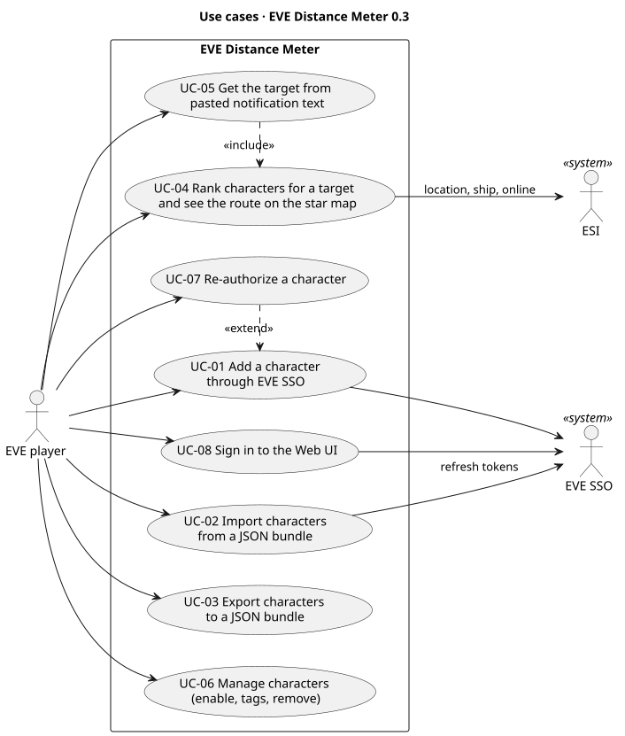

## C1 · System context
Actors are the user, EVE SSO, ESI (which also forwards an autopilot destination to the game client on **Set
destination**), zKillboard's live killmail feed R2Z2 (structure alerts), EVE Ref's structure dataset, Discord webhooks
(optional posts) and CCP static data.

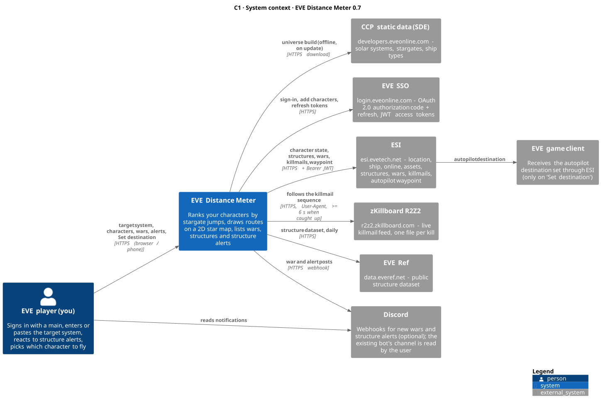

## C2 · Containers
One Python process serves the browser UI and the JSON API and runs three background tasks in its event loop: the
war watcher, the structure scout and the alert service. A one-file SQLite database (WAL) and the logs live on the
`/app/data` volume; the universe file is bundled. The desktop app (PySide6) is planned and will reuse the same core package.

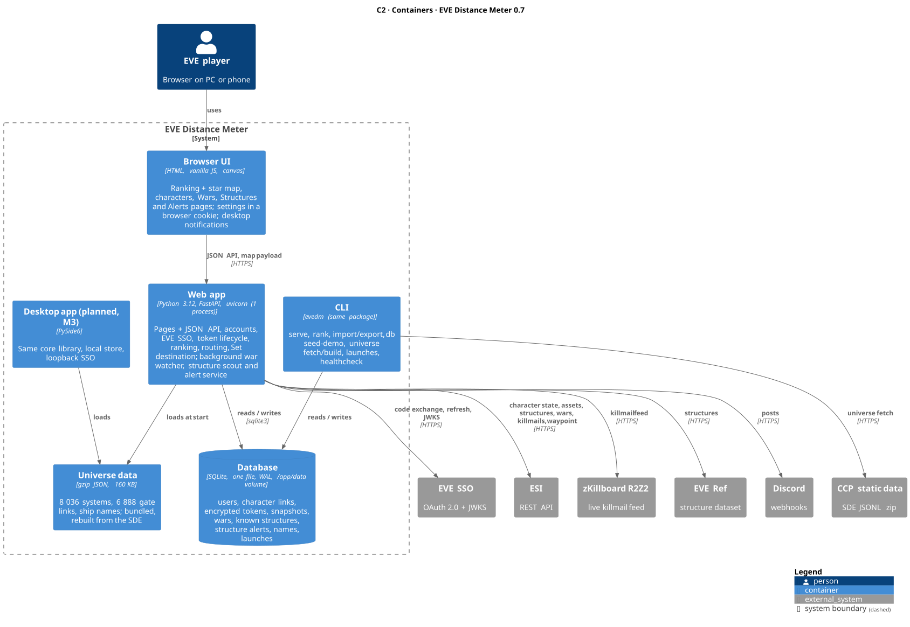

## C3 · Components of the web app

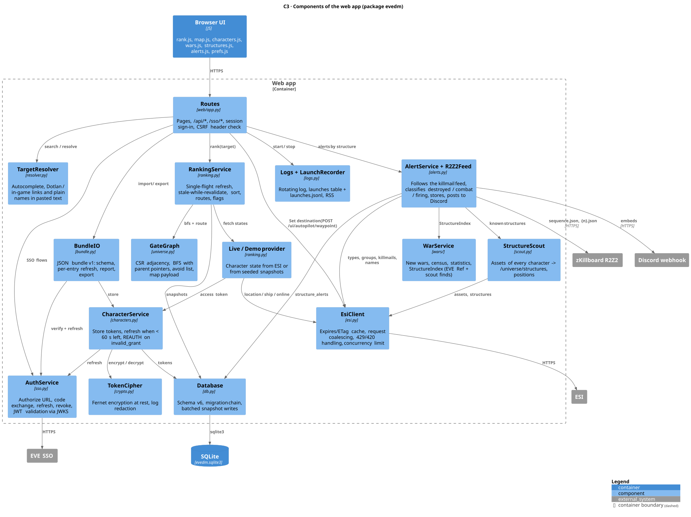

Key mechanisms:

- **Single-flight refresh + stale-while-revalidate** (`RankingService`): concurrent rankings share one ESI round; answers come
  from snapshots younger than 30 s while a background round runs every 5 s at most. The Refresh button waits for fresh data.
- **ESI client**: Expires/ETag cache, identical in-flight requests coalesced, 20 parallel calls, 429 Retry-After, 420 stop.
- **GateGraph**: CSR adjacency arrays; one BFS per target (cached) gives every character's route through parent pointers.
- **Tokens**: Fernet-encrypted in SQLite; refreshed when less than 60 s remain; `invalid_grant` marks the character REAUTH.
- **Structure alerts** (`AlertService`, 0.7.0): `R2Z2Feed` follows zKillboard's sequence (position kept in the `meta`
  table, 404 = caught up, 403/429 = 10 min pause). Each killmail is classified against the known structures of its
  system (scout finds + EVE Ref, positions in meters): structure victim → destroyed (core drop for citadels,
  engineering complexes, refineries), kill within `grid_km` → combat, structure attacker → firing. Alerts are stored
  once (unique index) and posted to Discord with a per-structure cooldown. The Alerts API groups them by structure
  and adds the main's three closest characters from the same cached per-target BFS the ranking uses.

## C4 · Code

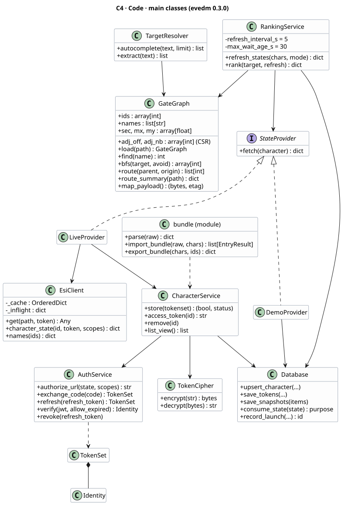

## Deployment

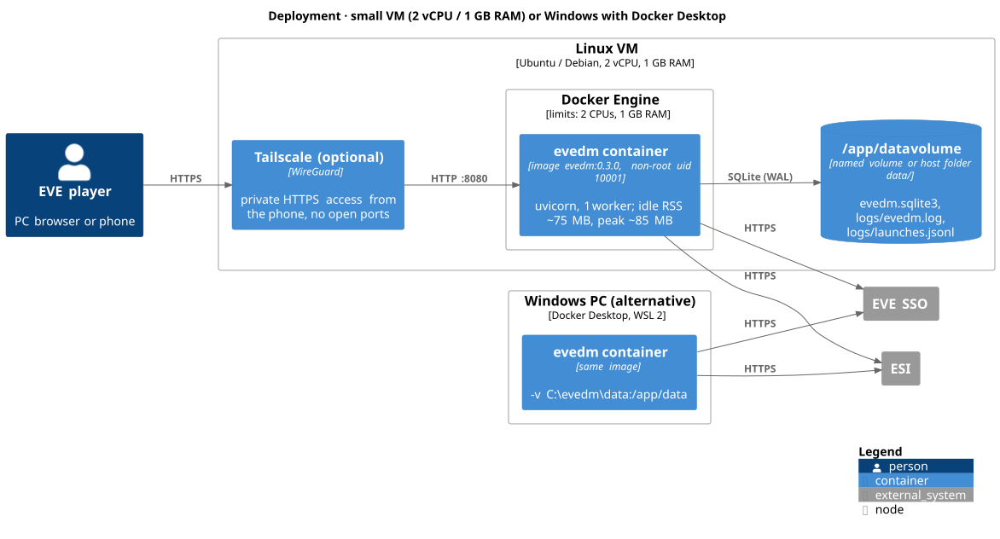

## Sequences

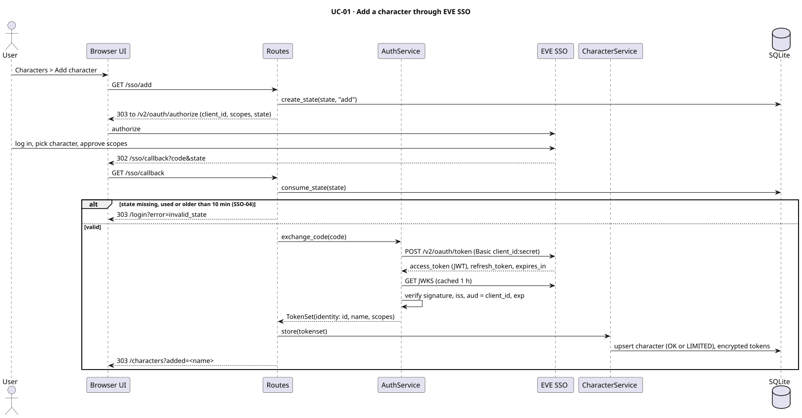

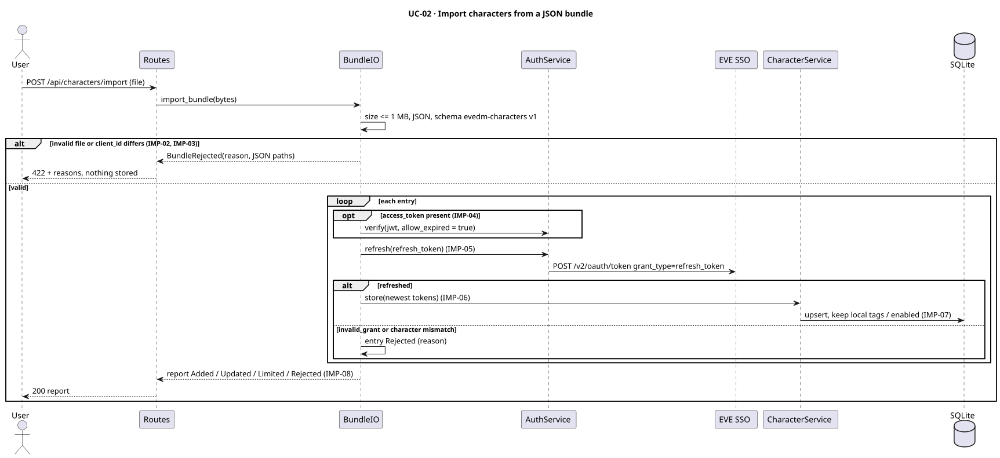

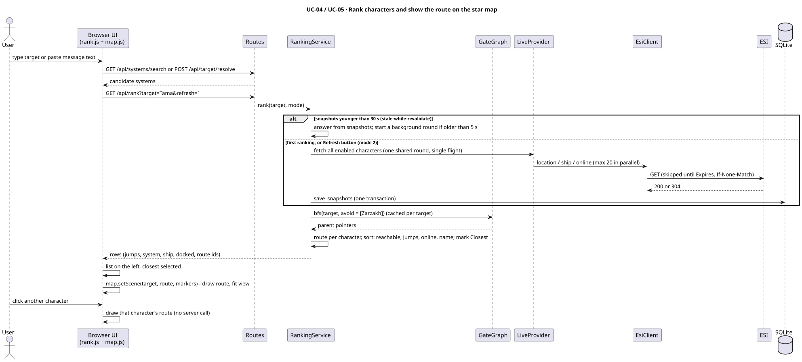

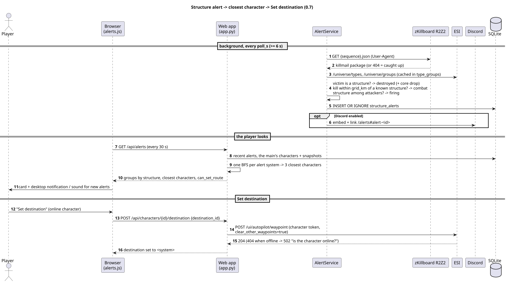

## Data model

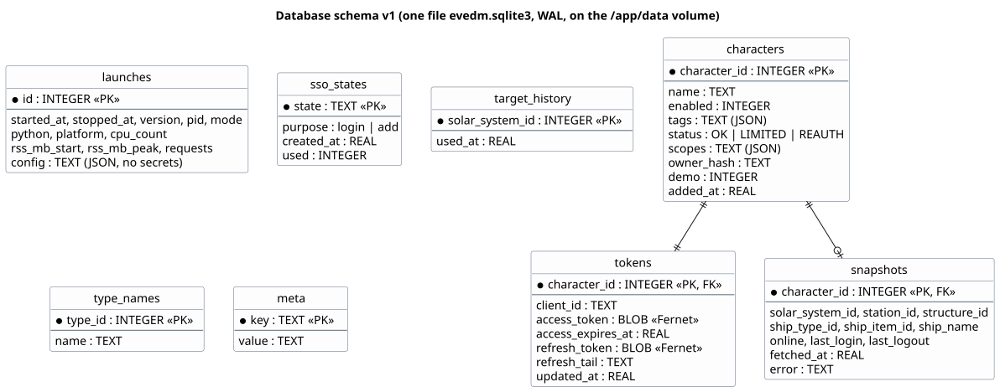

## CI pipeline

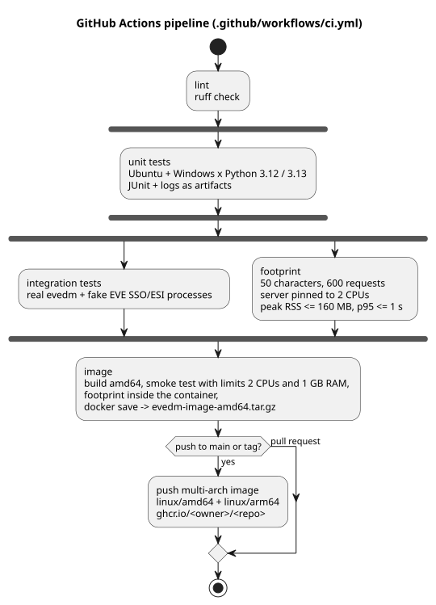
