# 02 · Architecture (C4 model)

Diagrams are written in PlantUML ([`docs/c4`](../c4)) and rendered to SVG/PNG in [`docs/diagrams`](../diagrams) with
`scripts/render-diagrams.sh` (set `PLANTUML_JAR` or install `plantuml`).

## Use cases

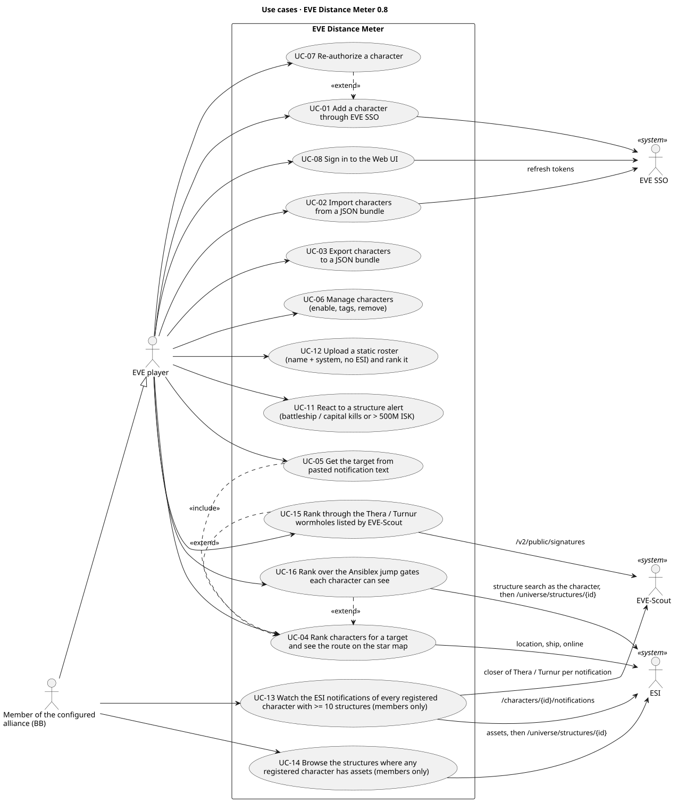

## C1 · System context
Actors are the user, EVE SSO, ESI (which also forwards an autopilot destination to the game client on **Set
destination**), zKillboard's live killmail feed R2Z2 (structure alerts), EVE Ref's structure dataset, Discord webhooks
(optional posts) and CCP static data.

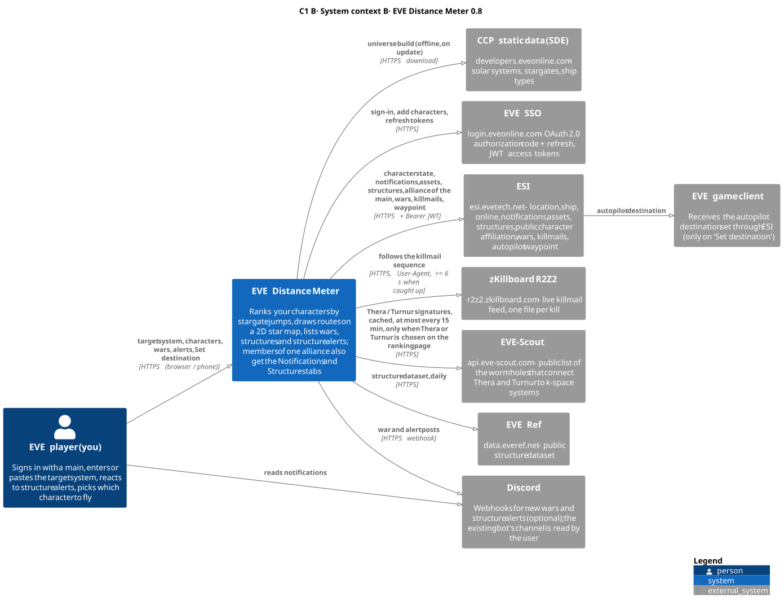

## C2 · Containers
One Python process serves the browser UI and the JSON API and runs four background tasks in its event loop: the
war watcher, the structure scout, the notification poller and the alert service. A one-file SQLite database (WAL) and the logs live on the
`/app/data` volume; the universe file is bundled. The desktop app (PySide6) is planned and will reuse the same core package.

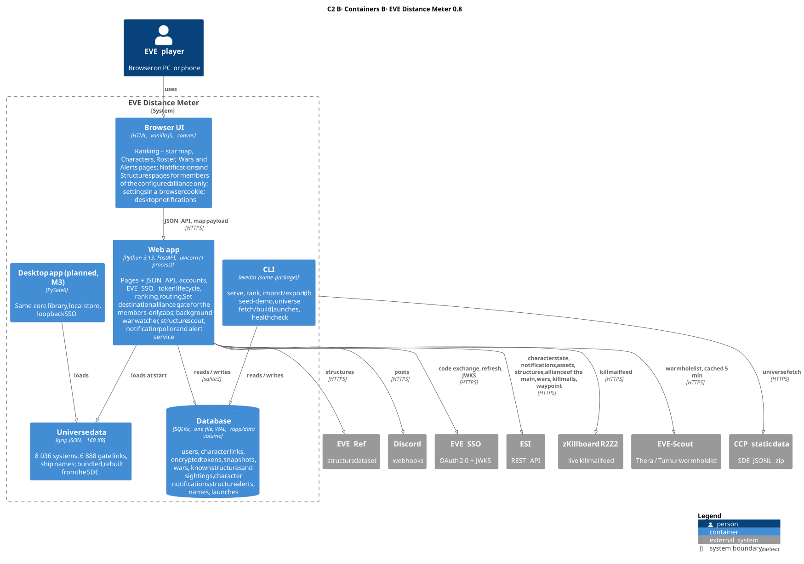

## C3 · Components of the web app

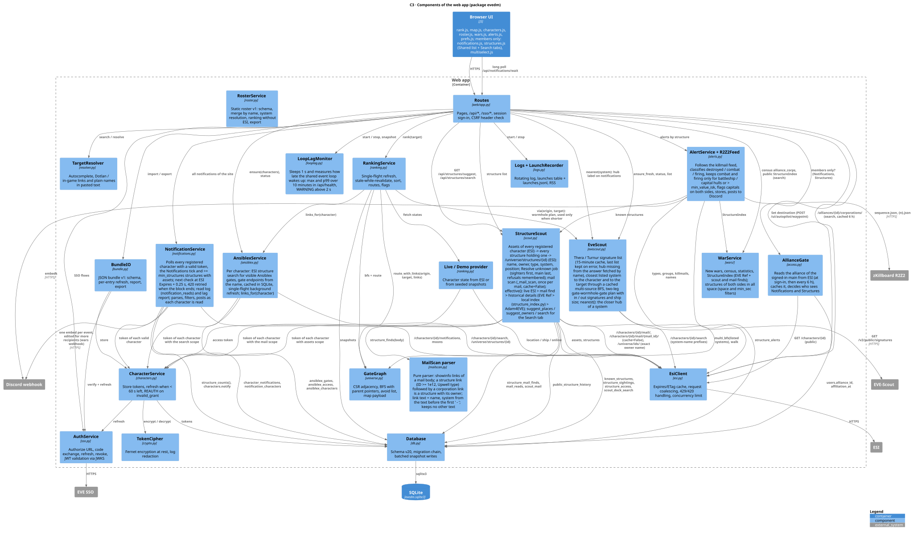

Key mechanisms:

- **Single-flight refresh + stale-while-revalidate** (`RankingService`): concurrent rankings share one ESI round; answers come
  from snapshots younger than 30 s while a background round runs every 5 s at most. The Refresh button waits for fresh data.
- **ESI client**: Expires/ETag cache, identical in-flight requests coalesced, 20 parallel calls, 429 Retry-After. On 420 it reads `X-Esi-Error-Limit-Remain/Reset`, **stops sending until the window resets** and fails fast (`blocked_for()`); paged reads are an async generator (`iter_pages`).
- **GateGraph**: CSR adjacency arrays; one BFS per target (cached) gives every character's route through parent pointers.
- **Tokens**: Fernet-encrypted in SQLite; refreshed when less than 60 s remain; `invalid_grant` marks the character REAUTH.
- **Structure scout** (`StructureScout`): assets are read page by page and each page's structures (type `other`) are upserted at once; known structures are skipped and kept until a 404; names and owners re-read every 720 h, refused ones every 14 days; stops at 60 ESI errors left.
- **EVE-Scout** (`EveScout`): public signature list cached 15 minutes (a hub missing from the answer is fetched by name), last list kept on error; `via()` builds character → entry → hub → exit → target for the chosen hub from a multi-source BFS.
- **Structure alerts** (`AlertService`, 0.7.0): `R2Z2Feed` follows zKillboard's sequence (position kept in the `meta`
  table, 404 = caught up, 403/429 = 10 min pause). Each killmail is classified against the known structures of its
  system (scout finds + EVE Ref, positions in meters): structure victim → destroyed (core drop for citadels,
  engineering complexes, refineries), kill within `grid_km` → combat, structure attacker → firing. Alerts are stored
  once (unique index) and posted to Discord with a per-structure cooldown. The Alerts API groups them by structure
  and adds the main's three closest characters from the same cached per-target BFS the ranking uses.

- **Alliance gate** (`AllianceGate`, `access.py`): the Notifications and Structures tabs are members-only. The
  alliance of the main that signed in is read from ESI (public `/characters/{id}`) at sign-in, stored on the
  account (`users.alliance_id`) and read again every 6 hours; navigation, pages and APIs all ask the same gate and
  answer 404 for anyone else, so there is no link to find and no endpoint to probe.
- **Notifications for the whole site** (`NotificationService`): every registered character with the notifications
  scope and a valid token is polled with its own token once per ESI cache window (600 s), whoever linked it; the
  page lists them all and adds the viewer's own three closest characters to each card. A character is polled only
  when its `notify` tick is on and `structure_counts()` (player structures, location id >= 1e12, holding assets) reaches
  `min_structures` (10). The next check is `Expires` + 1 s from ESI (`esi.cached_expiry`), clamped to
  `min_interval_s`..`character_interval_s`; transient errors retry after `retry_s`; the loop sleeps until the earliest due
  character. Each card gets the closer of Thera / Turnur (`EveScout.nearest`) and each closest character its route type.
  Kept fast: a re-read parses only entries not stored yet (`Database.notification_ids`, libyaml loader), any failure
  backs the character off, the purge runs hourly over an index on `created_at` (schema v10), the API measures each
  system once per request and never waits for EVE-Scout once a list exists (`ensure_fresh_soon`), and the page
  redraws only when the answer changed. Delivery: reads are spread over ESI's window (`staggered()`), a stored
  notification bumps `version` and wakes the pages holding `GET /api/notifications/wait` (long poll), and
  `post_discord()` sends one embed per event through the wars webhook (`DiscordNotifier.send` / `edit`,
  `notification_posts`, `character_notifications.posted`; schema v11). Schema v12/v13 add `public_structure_history`
  (historical structure details with their source).
- **Big-kill filter** (`alerts.py`): `hull_class()` maps a hull's ESI group to battleship (Battleship, Black Ops,
  Marauder) or capital (Carrier, Dreadnought, Lancer, FAX, Supercarrier, Titan, Capital Industrial); `weigh()` returns
  (big, capitals). Combat / firing alerts without a big hull or `min_value_isk` are dropped; the `capitals` flag is stored.
- **Ansiblex** (`AnsiblexService`, `ansiblex.py`): per character, ESI structure search (`esi-search.search_structures.v1`,
  term " » ") lists visible gates, `/universe/structures/{id}` names them; the "A » B - name" convention gives the two
  systems. `UniverseGraph.route_with_links` runs the BFS over stargates plus the character's one-way links (1 jump each);
  `RankingService` adds `ansiblex` and `route_legs` (mode `ansiblex`). Single-flight background refresh.
- **Structures from assets** (`StructureScout`): the assets of every registered character (ESI) reveal the structure
  IDs where something is stored (flag Hangar, Deliveries or AssetSafety, and not one of the character's own item
  IDs; the whole list is read first, nothing is saved after a failed or cut-short read); each ID is then read from `/universe/structures/{id}` with the token of a
  character that has an asset there (next character on 403). The pooled result feeds the Structures page.
  **Resolve unknown** (`POST /api/structures/resolve`) starts a background job that reads what is still unresolved
  with the characters that hold assets there (those of the signed-in main first) and the main last; a 403 is kept
  per (structure, character) in `structure_refusals` and not repeated for 14 days, and the job waits out ESI's
  error window instead of stopping (`GET /api/structures/resolve` is its state, `.../resolve/stop` cancels it).
  **Dock search** (`StructureScout._dock_search`, shared request `esi.search_structure_ids`, also used by
  Ansiblex): live ESI matches the start of a name, so each character with the search and structures scopes is
  searched with the 3-character prefixes of all system names (`dock_prefixes`, home region first), 200 terms per due
  run from a cursor; a term at the cap is split into full system names. Hits go to `structure_access` (with the
  `term` that found them; new IDs also to `known_structures`), per-character state to `scout_dock_search` (`cursor`,
  `passes`, `pass_started_at`, `capped`). A term below the cap drops what it no longer returns, rows age out after
  `max(30 days, 2 x a pass)`. Characters with an access row are asked first when a structure is read, the orphan purge
  spares such rows, and the shared list shows counts only (`dock_by`). The Wars structure lists and the alert matcher
  use all resolved structures, the notification gate and the Characters count stay on assets. `search-probe
  --self-test` checks the prefix match on known structures.
  Structures nobody may read get historical details in `public_structure_history`, by source rank: EVE Ref
  (daily download), the local index (`structure_index.py` reads `data/structure-index.jsonl`, built offline by
  `scripts/build_structure_index.py`; read on every scout run, no network), Adam4EVE (daily). Live ESI data always
  wins over all three.

## C4 · Code

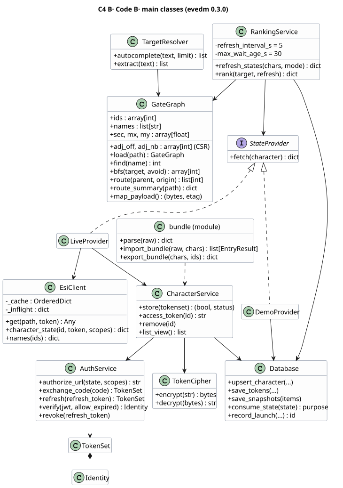

## Deployment

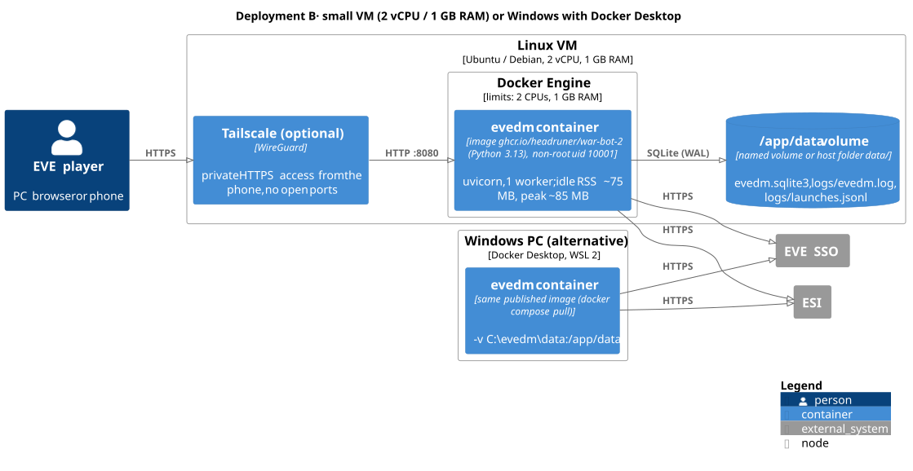

## Sequences

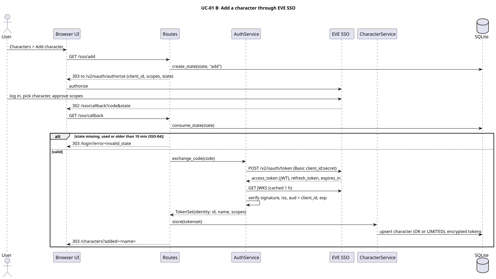

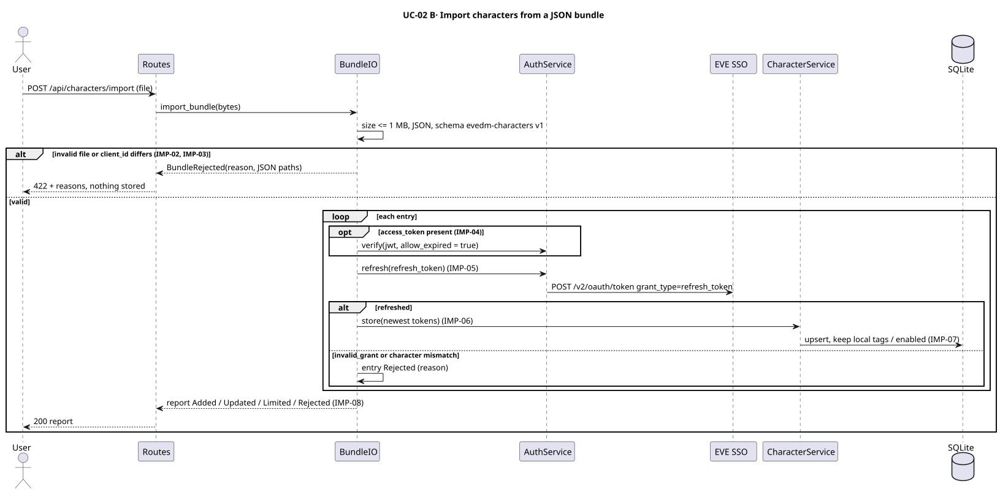

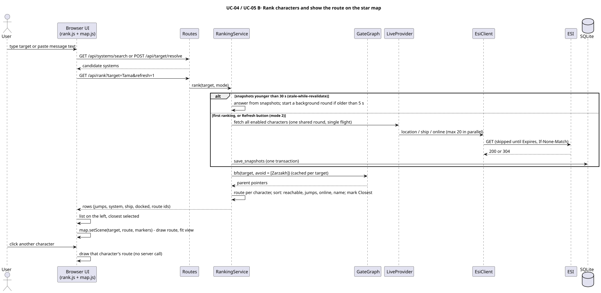

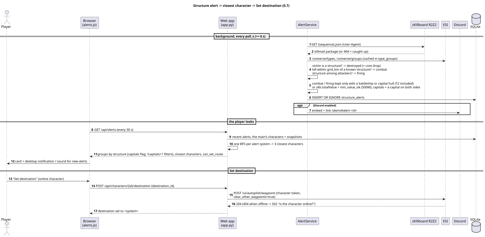

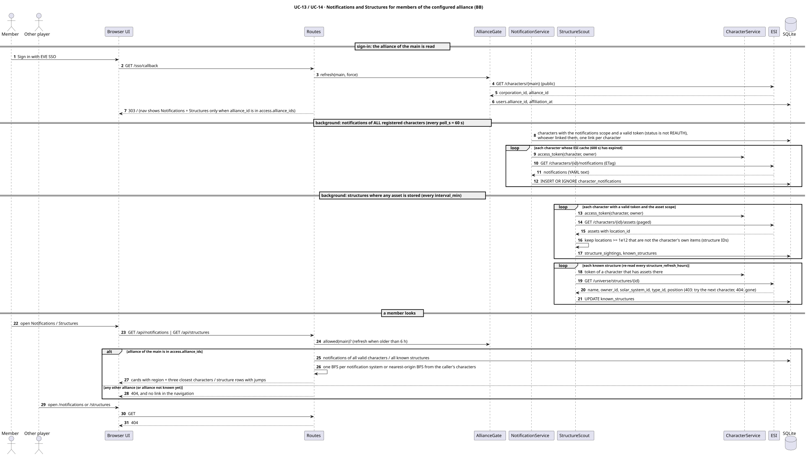

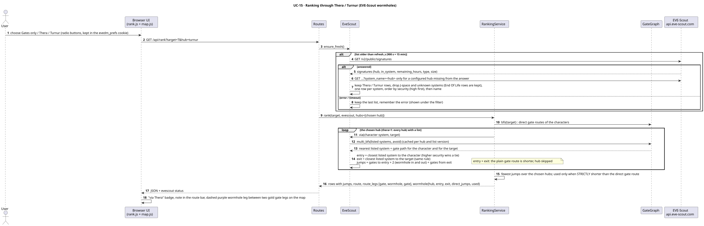

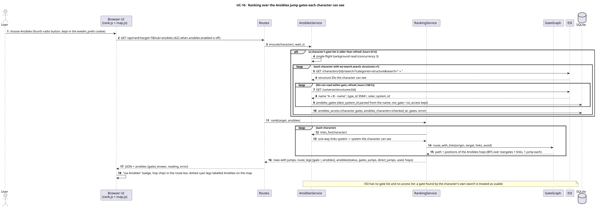

## Data model

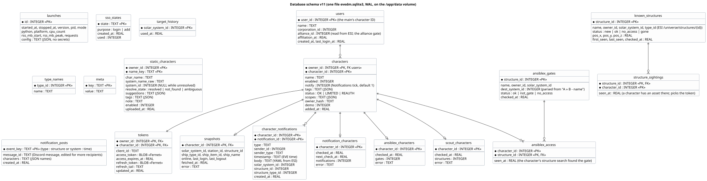

## CI pipeline

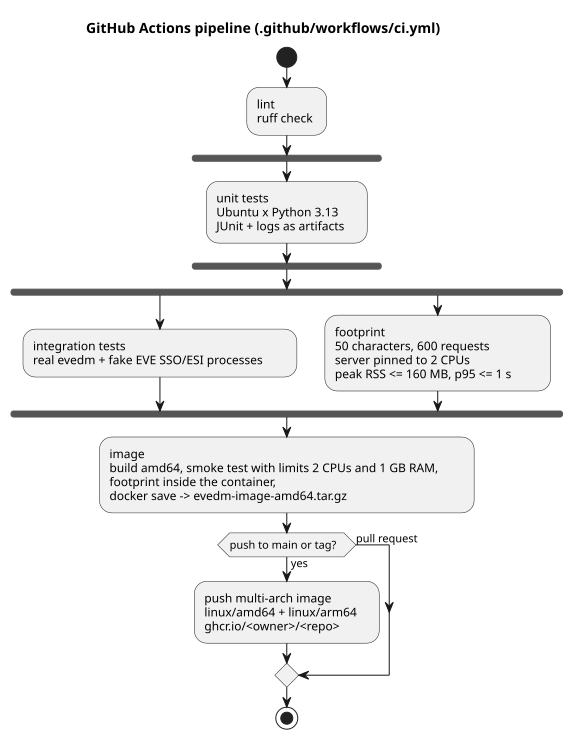
