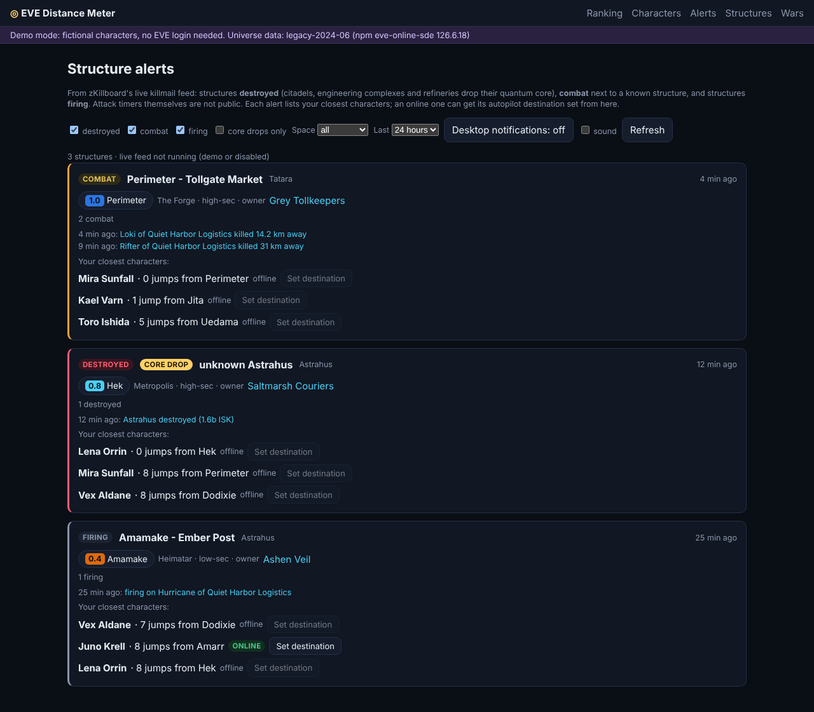

# 07 · Run on Windows (Docker Desktop)

Step-by-step guide for running EVE Distance Meter on a Windows PC with Docker Desktop.
All commands are for **PowerShell**, run from the repository folder `C:\Users\<you>\source\repos\evedm`.

## 0. Prerequisites

1. Docker Desktop running in **Linux containers** mode (default; tray icon > "Switch to Windows containers…" must *not* be active).
2. Check it:
   ```powershell
   docker version          # Server: OS/Arch must be linux/amd64
   docker compose version
   ```
3. Port 8080 free: `netstat -ano | findstr :8080` (no output = free). Otherwise pick another port for `EVEDM_PUBLISH`
   in `.env` (step 4).

## 1. Get the image (published image, nothing is built)

CI builds the image (Python 3.13), tests it and publishes it to GitHub Container Registry. Windows pulls it:
```powershell
docker pull ghcr.io/headruner/war-bot-2:latest
docker image ls ghcr.io/headruner/war-bot-2
```
A private package needs `docker login ghcr.io` first (username = your GitHub name, password = a token with `read:packages`).
To pin a release use a tag, e.g. `ghcr.io/headruner/war-bot-2:v0.8.0`, and put it in `.env` as `EVEDM_IMAGE=...`.
You need the repository only for `docker-compose.yml`, `.env.example`, `config\` and `scripts\`; Python is not needed.
Building from source is optional: `docker build -t evedm:0.8.0 .` or `scripts\update.ps1 -Build`.

**Offline alternative (older 0.3.0 image, no accounts or Wars page)** - `powershell -ExecutionPolicy Bypass -File .\scripts\load-image.ps1`.

## 2. Smoke test in demo mode (no EVE application needed)

```powershell
docker run --rm -p 8080:8080 -e EVEDM_DEMO=1 -e EVEDM_SECRET_KEY=demo ghcr.io/headruner/war-bot-2:latest
```
Open <http://localhost:8080/?target=Tama>. Stop with `Ctrl+C`.

Demo with the prepopulated database (10 fictional characters):
```powershell
docker run --rm -p 8080:8080 -v "${PWD}\data\demo:/app/data" `
  -e EVEDM_DEMO=1 -e EVEDM_SECRET_KEY=demo-secret-key-change-me ghcr.io/headruner/war-bot-2:latest
```

## 3. Register your EVE application (once)

1. <https://developers.eveonline.com/applications> > Create application (Authentication & API Access).
2. Callback URL: `http://localhost:8080/sso/callback` (must match `EVE_CALLBACK_URL` exactly).
3. Scopes: `esi-location.read_location.v1`, `esi-location.read_ship_type.v1`, `esi-location.read_online.v1`,
   `esi-characters.read_notifications.v1` (Notifications page), for the Structures page
   `esi-universe.read_structures.v1`, `esi-assets.read_assets.v1`, for the Ansiblex route mode
   `esi-search.search_structures.v1`, for the structures named in in-game mails `esi-mail.read_mail.v1`, and for **Set
   destination** `esi-ui.write_waypoint.v1`. EVE SSO refuses the sign-in (`invalid_scope`) while one of them is
   missing on the application (the mail scope is new after 0.8.0: tick it before upgrading);
   `EVE_OPTIONAL_SCOPES=none` leaves the last five out; if you set `EVE_OPTIONAL_SCOPES` in `.env` yourself, add
   `esi-mail.read_mail.v1` to it.
4. Copy the **Client ID** and **Secret Key**.

## 4. Create `.env`

```powershell
Copy-Item .env.example .env
# generate a strong secret key and print it
$b = New-Object byte[] 48; [Security.Cryptography.RandomNumberGenerator]::Create().GetBytes($b); [Convert]::ToBase64String($b)
notepad .env
```
Fill in:
```
EVEDM_SECRET_KEY=<the generated value - keep it; tokens cannot be decrypted without it>
EVE_CLIENT_ID=<client id>
EVE_CLIENT_SECRET=<secret key>
EVE_CALLBACK_URL=http://localhost:8080/sso/callback
EVEDM_PUBLISH=8080          # port 8080 taken: 8081 here, and :8081 in EVE_CALLBACK_URL and on the EVE application
EVEDM_ALLOWED_LOGIN_CHARACTERS=<your main character ID, comma-separated for several>
EVEDM_DEMO=0
EVEDM_SQLITE_JOURNAL=wal
EVEDM_WARS_ENABLED=1
EVEDM_WARS_CONTACT=<your e-mail or character name, sent to ESI>
# optional: also post new wars to Discord
EVEDM_WARS_DISCORD_ENABLED=0
EVEDM_WARS_DISCORD_WEBHOOK=
```
Character ID: the number in your character's URL on zkillboard.com or evewho.com.
Empty `EVEDM_ALLOWED_LOGIN_CHARACTERS` = any EVE character can sign in and get its own account (see section 9).
To reach the app from this PC only, bind it to the loopback address: `EVEDM_PUBLISH=127.0.0.1:8081`.

## 5. Start

Data folder on the host (`.\data` → `/app/data`), as in `docker-compose.yml`:
```powershell
powershell -ExecutionPolicy Bypass -File .\scripts\update.ps1   # pulls the published image and starts it (same as: docker compose pull; docker compose up -d --no-build)
docker compose ps              # STATUS should become "healthy" within ~30 s
docker compose logs -f evedm   # Ctrl+C to stop following
```
Open <http://localhost:8080>, sign in with EVE SSO, then **Characters > Add character** or **Import JSON**.
Rank: type or paste a system name (or a Dotlan / zKillboard / in-game link) on the main page.

Alternative with a named Docker volume (WAL always available, port bound to 127.0.0.1 only):
```powershell
docker compose -f deploy/docker-compose.yml up -d
```

## 6. Check it works

```powershell
curl.exe http://localhost:8080/api/health
docker exec evedm evedm check
docker exec evedm evedm rank Jita
```
Files on the host: `data\evedm.sqlite3`, `data\logs\evedm.log`, `data\logs\launches.jsonl`.

## 7. Daily operations

| Task | Command |
| --- | --- |
| Stop / start | `docker compose stop` / `docker compose start` |
| Remove container (data stays in `.\data`) | `docker compose down` |
| Backup tokens | Characters > Export JSON, or `docker exec evedm evedm export --out /app/data/backup.json` |
| Backup DB | `docker compose stop`, copy `data\evedm.sqlite3`, `docker compose start` |
| Update to the latest image | `powershell -ExecutionPolicy Bypass -File .\scripts\update.ps1` (pull, restart, health check; `-Build` builds from your checkout instead, `-Push` pushes it to GitHub first) |
| War watcher settings | edit `config\wars.yaml`, then `docker compose restart` (mounted read-only, no rebuild) |
| Wars from the console | `docker exec evedm evedm wars list`, `docker exec evedm evedm wars stats --months 12` |

## 8. Troubleshooting (Windows specifics)

| Symptom | Fix |
| --- | --- |
| `update.ps1` / `load-image.ps1 cannot be loaded … execution policy` | run it via `powershell -ExecutionPolicy Bypass -File …` |
| `unauthorized` or `denied` while pulling from ghcr.io | the package is private: `docker login ghcr.io` (token with `read:packages`) or make the package public |
| `checksum mismatch` | a part file is incomplete: delete `image\evedm-image-0.3.0-amd64.tar.gz`, restore the parts with `git checkout -- image`, retry |
| `pull access denied for evedm, repository does not exist` | `EVEDM_IMAGE` is not set and `evedm:0.8.0` was never built: run `scripts\update.ps1` (pulls the published image) or `docker build -t evedm:0.8.0 .` |
| `no matching manifest for windows/amd64` | Docker Desktop is in Windows-containers mode; switch to Linux containers |
| `port is already allocated` | set `EVEDM_PUBLISH=8081` in `.env` and update `EVE_CALLBACK_URL` and the callback in your EVE application to port 8081 |
| `missing required settings` | `.env` lacks `EVEDM_SECRET_KEY`, `EVE_CLIENT_ID` or `EVE_CLIENT_SECRET` |
| Sign-in refused (`not_allowed`) | add your character ID to `EVEDM_ALLOWED_LOGIN_CHARACTERS`, then `docker compose up -d` |
| SSO error about redirect / callback | callback URL in the EVE application and `EVE_CALLBACK_URL` differ (scheme, host, port) |
| Log: `journal_mode=WAL unavailable` | normal on some Windows bind mounts; app fell back to rollback journal. Use the named-volume variant to keep WAL |
| `cannot decrypt token` | `EVEDM_SECRET_KEY` changed; restore the old one or re-add characters |
| Shell scripts fail with `\r` errors (only if you run `scripts/*.sh` in WSL/Git Bash) | repo enforces LF via `.gitattributes`; run `git add --renormalize .` or re-clone |

## 9. Accounts: one site, several players

- Each player signs in with their **main** character. That creates their account and links the main to it.
- **Characters > Add character** (or Import JSON) links more characters to the signed-in main. Each player sees and
  ranks only their own characters. The same character can be linked by two players; each link has its own token.
- The sign-in lasts 90 days after the last visit on that browser (`web.session_days` in `config/evedm.example.yaml`).
  The cookie only identifies the main; tokens are kept encrypted in `data\evedm.sqlite3`.
- **Characters > Delete account** removes the main and all its links and revokes their tokens.
- Upgrading from 0.3.0: characters added before accounts existed are taken over automatically by the first main
  that signs in and is one of them. If your main was not among them, move them once:
  `docker exec evedm evedm users adopt --to <your main character ID>` (`evedm users list` shows the mains).

## 10. Wars page (merged eve-war-bot-2)

- **New wars**: the watcher checks ESI for new war declarations every 15 minutes, newest first. Each war lists the
  systems of both sides' public structures and the systems with recent kills. Click one to rank your characters.
- **Statistics**: every active war in New Eden (fighting, starting within 24 h, ending): counts, most active
  aggressors, most war-decced corporations, most destructive wars, structures at war (all space) and high-sec
  structures at war by type and region.
  The first scan walks back through the newest 20,000 war IDs in the background (about 20 cycles of 15 minutes);
  the coverage line under the tables shows its progress.
- **Structures at war** (until 0.8.0 "High-sec structures"): the known structures of both sides of every active war
  in all space, nearest to your own characters first, with the war state (fighting, starts in …, ends in …). Filter by
  type, region, side, war state, space (high-sec, low-sec, null-sec, wormhole) and security (default any); click the
  system to rank your characters (wormhole systems have no gates, so no jumps and no link).
- The chosen tab, the filters and the ranking's
  auto-refresh interval are remembered in a cookie of your browser (`evedm_prefs`, one year); nothing is stored on
  the server, so another browser starts with the defaults.
- Settings: `config\wars.yaml` (its own file). Switch it off with `EVEDM_WARS_ENABLED=0` in `.env`.
- Discord posting (what the old bot did): set `EVEDM_WARS_DISCORD_ENABLED=1` and `EVEDM_WARS_DISCORD_WEBHOOK=<url>`
  in `.env`, then `docker compose up -d --force-recreate`. Messages link back to the Wars page; set
  `EVEDM_PUBLIC_URL` (for example your Tailscale address) so the link works for others.
- Stop the old eve-war-bot-2 container if both would post to the same channel.

## 11. Structures page (structure scout)

- Lists the player-owned structures (Upwell: citadels, engineering complexes, refineries, Keepstars …) in every kind
  of space where **any** character registered on the site has an asset. The assets come from ESI; each structure ID
  found there is then read from ESI for its name, owner, type and system. The tab is open to members of the
  configured alliance (BB) only (see the Notifications section for `access.alliance_ids`); they all see the same
  pooled list, sorted by jumps from their own nearest character; NPC stations never appear.
- It needs extra scopes on your EVE application: tick `esi-universe.read_structures.v1` and
  `esi-assets.read_assets.v1` on developers.eveonline.com **before** upgrading, and `esi-mail.read_mail.v1` for the
  mail scan below, otherwise sign-in fails with `invalid_scope` (or set `EVE_OPTIONAL_SCOPES=none` in `.env` until you
  have).
- Characters added before need to grant them once: sign in again with the main and use **Add character** for each
  alt. The Characters page says "structures not shared" for characters that have not. A character added before the
  mail scope existed is not read for mails until it has been added again.
- The scout runs every 60 minutes and reads each character's assets once a day. The whole list is read first and
  only then saved: a read that fails or is cut short saves nothing and keeps the earlier finds. Only items in a
  Hangar, Deliveries or AssetSafety flag count, and not when the place is one of the character's own ships or
  containers (those, NPC stations and fitted modules are not structures). After an upgrade from an older rule each
  character is read again at once and the ships and containers stored as structures are removed automatically (the
  Characters page counts drop to the real numbers). A structure stays in the database until it is destroyed or
  unanchored, even when no character can read it any more; names and owners are re-read every 30 days and refused
  ones every 14 days.
- Structures of corporations at war (from the Wars census) are marked **at war**, and they also appear in the Wars
  page's Structures at war tab (all space, not only high-sec).
- The search box and filters are remembered in your browser like the other settings. **Source** chooses what is
  listed: *with assets* (the default: structures where a registered character has items), *can dock, no assets*,
  *named in mails* or *all*. "Can dock" means ESI's character search (`esi-search.search_structures.v1`, the scope Ansiblex mode already
  asks for) returned the structure for at least one registered character, so that character may dock there even
  without items; the page shows only how many characters can dock, never which. ESI's search matches the start of a
  name, so each character is searched with the first three letters of every system name (its own region first,
  200 searches per hourly run: the first full pass takes about a day, afterwards one run a day). Prefixes with a
  hyphen (null-sec names such as H-PA29) are not verified live: `evedm structures search-probe --self-test` checks
  them on known structures and names the setting to use (`structures.dock_search_punctuated: full`). A result at
  the cap is split into full system names and never assumed complete (see 06 · Operations).
- **Mails**: with `esi-mail.read_mail.v1` granted, the scout opens the in-game mails of every registered character
  once an hour and picks out a structure link followed by its owner corporation's link (drag both into a mail to
  report a structure). The structure joins the list as *named in mails* with the owner and the mail's date; live ESI
  data replaces it as soon as a character can read the structure. Only the structure, type and corporation IDs, the
  link text, the mail ID and its timestamp are stored; the mail itself (body, subject, sender, recipients) is never
  stored or logged. Switch the scan off with `structures.mail_enabled: false` in the YAML config file (`EVEDM_CONFIG`, see `config\evedm.example.yaml`); the other
  settings are `mail_refresh_minutes` (60), `mail_max_pages` (4) and `mail_max_age_days` (30).
- **Search tab**: finds citadels, known and unknown, by system or region and by corporation or alliance. Type two
  letters into either box, pick a suggestion (mouse or arrow keys and Enter) and the table follows each change; a
  structure must match every box that is filled in, and any one of several choices in a box. *Show* limits the
  list to known or unknown citadels. Structures of EVE Ref's public dataset are listed too.
- **Resolve unknown** (button on the page) starts a background job that first scans the mails and then reads every structure still missing a name,
  owner or system: ESI's public list first, then structures with a character that holds assets there (yours first),
  your main last (`esi-universe.read_structures.v1`). A refusal is remembered per structure and character for 14
  days. When ESI's error limit runs low the job waits for the window and goes on by itself, so one click is enough;
  the page shows the progress (also after a reload) and a **Stop** button. `evedm structures stats` prints how many
  are still unknown and askable.
- Structures nobody here may read are filled from public data and marked **Historical details: <source>**: EVE Ref,
  then the local index, then Adam4EVE (live ESI data always wins). Build the local index once on any PC with Python:
  `python scripts\build_structure_index.py`, then copy `data\structure-index.jsonl` into the `data` folder the
  container uses (details in 06 · Operations).


## 12. Alerts page (structure alerts) and Set destination



- **What it watches**: zKillboard's live killmail feed (all of New Eden, every kind of space). Attack timers
  (shield, armour, hull reinforcement) are not public, only the owner corporation's directors get them, so the app
  uses what killmails show:
  - **Destroyed**: a structure died. Citadels, engineering complexes and refineries drop their **quantum core** in
    the wreck (marked "Core drop"); jump gates, cyno beacons and the like do not.
  - **Combat**: a ship died within 1000 km of a structure the app knows the position of (Structures page and the
    public dataset), the best public hint that the structure is being shot or defended (`alerts.grid_km`).
  - **Firing**: a structure is on a killmail's attacker list, its guns or fighters are engaged.
- **Closest characters**: each alert card lists your three characters nearest by gates (last known location, online
  first on ties). Wormhole systems have no gate route.
- **Set destination**: for an online character the button sets the in-game autopilot destination to the alert's
  system (waypoints cleared first). It is greyed out for offline characters and for characters that have not granted
  `esi-ui.write_waypoint.v1`: tick that scope on your EVE application, then **Add character** again for each of them.
  On the Ranking page the same light-green button sits on the row of each online character, under the number of
  jumps and aligned right (nothing is shown when it succeeds; a refusal is); offline characters have none.
- **Notifications**: the page refreshes every 30 seconds. "Desktop notifications" asks your browser for permission
  and then shows a notice for every new alert while the page is open (in a background tab too); "sound" adds a beep.
  The filters (kinds, core drops only, space, period) and these choices are remembered in your browser.
- **Discord**: in `.env` set `EVEDM_ALERTS_DISCORD_ENABLED=1` and `EVEDM_ALERTS_DISCORD_WEBHOOK=<url>` (another
  channel than the wars one is fine), optionally `EVEDM_ALERTS_DISCORD_MENTION_ROLE_ID=<role id>` to ping a role on
  destroyed structures, then `docker compose up -d --force-recreate`. Combat and firing are posted at most once per
  structure per 30 minutes; each post links to the Alerts page (set `EVEDM_PUBLIC_URL` so the link works for others).
  Which kinds are posted: `alerts.discord.kinds` in `config/evedm.example.yaml`.
- Put your mail or Discord name into `EVEDM_ALERTS_CONTACT` so zKillboard can reach you about your traffic. Switch
  alerts off with `EVEDM_ALERTS_ENABLED=0`. Alerts are kept 7 days.
- **Big kills only**: combat and firing alerts are kept only when the kill has a battleship (Black Ops and Marauders
  included) or capital hull (T2 included) or a single loss above 500M ISK (`alerts.big_kills_only`,
  `alerts.min_value_isk`). Destroyed structures always alert. The **capitals** checkbox on the page shows only kills
  with at least one capital on each side.

## Notifications page (0.8.0, site-wide after 0.8.0)

The EVE notifications of **every character registered on the site that has a valid token**, read from ESI with
each character's own token: **assets moved to asset safety**, **structures under attack**, structure state and
fuel, starbase alerts. Each card names the character that received it (and its main), shows the system with its
security and region, the EVE time (no local time), a violet **Thera** or orange **Turnur** label for whichever hub is closer
to the system, and the three closest characters from *your* **Characters** set and *your*
**Roster** set (live characters with their route type: gates, Thera or Turnur; roster characters with jumps only), so you can see at a glance who is near.

- The **Notifications** and **Structures** tabs are open to one alliance (BB, 99010320): `access.alliance_ids` in
  `config/evedm.example.yaml` (or `EVEDM_ACCESS_ALLIANCES=99010320,...` in `.env`; the old
  `EVEDM_NOTIFICATIONS_ALLIANCES` still works). The alliance of the main that signs in is read from ESI at
  sign-in and again every 6 hours. Mains of other alliances do not see either link, and the pages answer 404.
  An empty list opens both tabs to every signed-in main.
- Every member sees the notifications of all registered characters, including those linked by other mains. A
  character is read when it has granted the notifications scope, its token has not been revoked, its **Notifications**
  tick on the Characters page is on (default) and it holds assets in at least **1 player structure** (NPC stations do
  not count; `notifications.min_structures`, 0 = everybody). The ranking on/off switch does not matter.
- It needs one more scope on your EVE application: tick `esi-characters.read_notifications.v1`, then
  **Add character** again for every character. A character that has not granted it is marked Limited and is
  never polled.
- ESI caches notifications for 600 seconds per character, so the app asks once per character per cache window
  and the page is told the moment a new one is stored (it also refreshes every 30 seconds). The next read of a character is scheduled at ESI's own cache expiry (not a fixed
  10 minutes after the last read, which could delay a notification by up to ~15-20 minutes); a transient ESI error
  is retried after 60 s (`notifications.retry_s`). `evedm notifications lag` shows where the time between a
  notification and its delivery goes.
- Everything else ESI sends (corporation mail, bills, insurance, sovereignty…) is filtered out until you tick it
  under **Filters**; types ESI sends that CCP added after this release appear under **Other notifications**.
  Your selection and the period are remembered in your browser.
- **Sound**: tick it for a short chime when a new notification matching your filters arrives while the page is
  visible. Browsers only allow sound after a click, so tick it again after reopening or reloading the page.
- **Fast delivery**: the page keeps one request open and reloads the moment a new notification is stored; the
  characters' reads are spread over ESI's 10-minute window, so an event several characters receive appears after
  the earliest of them. ESI's 10-minute cache per character remains the limit.
- **Discord**: new notifications are posted through the wars webhook (`EVEDM_WARS_DISCORD_WEBHOOK`), one message per
  event, edited to list every character that received it. Own channel: `EVEDM_NOTIFICATIONS_DISCORD_WEBHOOK`; ping a
  role on attacks: `EVEDM_NOTIFICATIONS_DISCORD_MENTION_ROLE_ID`; off: `EVEDM_NOTIFICATIONS_DISCORD_ENABLED=0`.
  Nothing older than an hour is posted, so switching it on does not flood the channel. Everyone in that channel
  sees the notifications of all registered characters.
- **Structure type**: every notification that names a structure shows its type (Astrahus, Fortizar...), "Unknown" if
  neither the notification nor the structures the app knows give it.
- **zKillboard check** (only "items moved to asset safety"): the card and the Discord message say whether a killmail
  of that structure type appeared in that system within 5 minutes of the notification. Killmails arrive late, so it
  checks every minute for 5 minutes ("checking... (2 of 6)"); the Discord message is edited when the check ends.
  "No kill" can also mean the owner unanchored the structure. Switch it off with
  `EVEDM_NOTIFICATIONS_ZKB_CHECK_ENABLED=0` (or `notifications.zkb_check.enabled: false`).
- Notifications are kept 30 days (`notifications.retention_days`). Switch the section off with
  `EVEDM_NOTIFICATIONS_ENABLED=0`.

## Thera / Turnur on the Ranking page

Next to the target box choose **Gates only**, **Thera** or **Turnur**. Each button uses only its own hub as the mid-system.
The app reads the wormhole list from `api.eve-scout.com` (cached, at most once every **15 minutes**, only while someone uses
it) and, for each character, offers the route *gates to the closest listed system, wormhole in and out of the hub, gates from
the listed system closest to the target*. Among equally close listed systems the one with the higher security is used. The hub
route is shown only when it is shorter than the gate route (a wormhole counts as two jumps); the route bar then reads "via
Thera: ..." and the map draws a dashed purple leg between two gold gate legs. Connections marked *End Of Life* on the EVE-Scout
site are kept; J-space exits are skipped because they have no gates. If EVE-Scout cannot be reached the last list is kept and
the error is shown above the list (the Ranking page has no "EVE-Scout: n listed systems" line). Switch it off with `EVEDM_EVESCOUT_ENABLED=0`; change the cache time with `EVEDM_EVESCOUT_REFRESH_S`. The
Roster tab is not affected.

The route bar shows **InSig / OutSig** (the signature IDs at the k-space system and at the hub) next to the entry and exit
systems, and the wormhole hop carries an icon of the **smallest ship size** of the two neighbouring systems: small, medium,
large, X-large or capital (from EVE-Scout's `max_ship_size`).

## Ansiblex routes on the Ranking page

The fourth radio button, **Ansiblex**, routes every character over stargates plus the Ansiblex jump gates **that
character can see**; each gate is one jump and is drawn as a dotted cyan leg labelled "Ansiblex". ESI has no list of gates
or of who may use them, so the app asks ESI's structure search as the character (term " » ") and reads each hit with
`/universe/structures/{id}`; a gate the character finds is treated as usable. Tick `esi-search.search_structures.v1` on
your EVE application and **Add character** again; the first use reads the gates in the background. Refresh times:
`ansiblex.refresh_hours` (6) and `ansiblex.gate_refresh_hours` (168); switch off with `EVEDM_ANSIBLEX_ENABLED=0`.

The **Auto-refresh** selector sits in the header of the Characters / Roster tabs and stays visible when a target is
selected. The Characters page no longer shows tokens.

## Page help and phones

Each page's explanation sits behind the **i** button at the right of the top bar (Escape or a tap outside closes
it). On a phone the ranking opens on a full-width map: the gear button on the map shows the target box, the zoom
buttons and auto-refresh; the route bar sits above the ranked characters; the page links wrap into two rows so all of
them fit one screen.

## Ranking page: list and route

Each character row shows the name with the ship type next to it, the system (security as a coloured figure without a
background) and online / last seen, with the number of jumps and the green **Set destination** button on the right. The
list shows the **3 closest** characters; **Show all** reveals the others. The last **5** targets are kept as quick-access
chips. The route bar lists system names only, cut to 7 symbols (hover for the full name). The page has no Refresh button
(use auto-refresh), no map legend and no map check-boxes.

## ESI error limit (`esi:420`)

ESI allows about 100 failed requests per minute. When the limit is reached (the structure scout can cause it) the app stops
calling ESI until the window resets; ranking rows keep their last data and show `esi:420`, then recover by themselves.
The Resolve unknown job on the Structures page waits for the window by itself ("Waiting N s for ESI's error window"):
do not click again, use **Stop** to cancel it.
